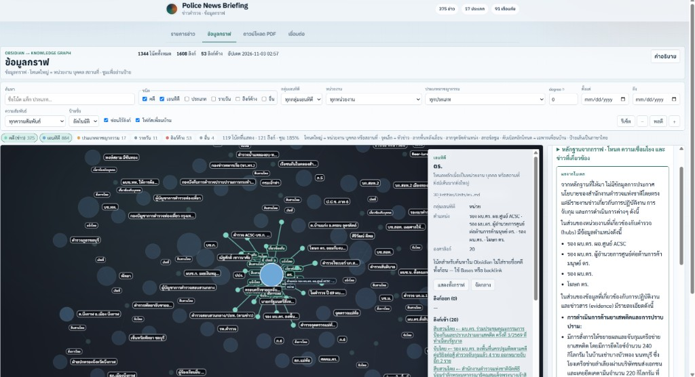
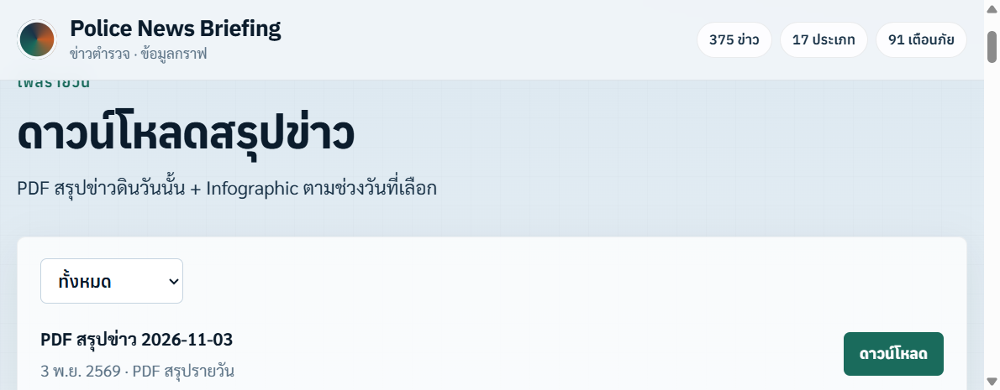
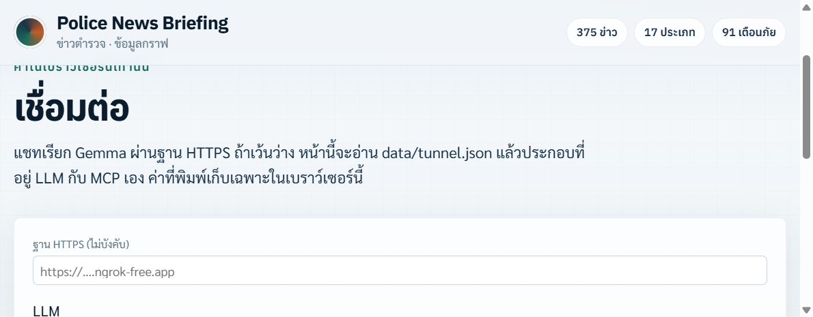

# ข่าวตำรวจ

ข่าวอาชญากรรมรายวันบน GitHub Pages

เว็บ: https://chiraleo2000.github.io/Police-news-intel-kit/

| มุมมอง | ที่อยู่ |
| --- | --- |
| รายการข่าว (ทุกประเภท รวมไซเบอร์) | `#/r/all` |
| ข่าวอาชญากรรมไซเบอร์ (แยกแท็บ) | `#/cyber/r/all` |
| ข่าวย้อนหลัง | `#/r/1` … หรือ `#/cyber/r/1` … |
| ข่าวหนึ่งเรื่อง | `#/{วันที่}/{รหัส}` · ไซเบอร์ `#/cyber/{วันที่}/{รหัส}` |
| ข้อมูลกราฟ (GraphRAG รวมทั้งหมด) | `#/brain` |
| ดาวน์โหลด | `#/downloads/r/all` |
| เชื่อมต่อ LLM | `#/connect` |

---

## หน้า GitHub Pages ใช้อย่างไร

เว็บนี้เป็นหน้าอ่านอย่างเดียว ข้อมูลมาจาก workspace ผลิตข่าว **`police-news-intel-private`** ทุกเช้า/บ่าย

### 1) รายการข่าว

- รวมข่าวทุกประเภท **รวมข่าวอาชญากรรมไซเบอร์**
- กรองประเภท / ช่วงวัน / แท็ก หรือค้นหาหน่วยงาน/จังหวัดได้

### 2) ข่าวอาชญากรรมไซเบอร์

- แท็บแยก แสดงเฉพาะประเภท **อาชญากรรมไซเบอร์และออนไลน์** (`*_cyber.json` + CYBER จาก Task 1/2)
- เส้นทาง `#/cyber/r/all` — เป็นมุมมองโฟกัส ไม่ตัดข่าวไซเบอร์ออกจากรายการข่าวหลัก

### 3) ข้อมูลกราฟ (GraphRAG)

- กราฟ**ก้อนเดียวรวมทุกประเภท** (รวมคดีไซเบอร์) — **ไม่มีแท็บกราฟไซเบอร์แยก**
- โหนดใหญ่ = หน่วยงาน บุคคล สถานที่ · จุดเล็ก = หัวข่าว
- คอลัมน์ขวาเป็น **ถามจากกราฟ** (GraphRAG)

### 4) ดาวน์โหลด PDF

- เลือกช่วงวัน แล้วดาวน์โหลด PDF สรุปรายวันและ Infographic (รวมชุด `_cyber` เมื่อมี)
- ไฟล์อยู่ใต้ `github-pages/data/downloads/`

### 5) เชื่อมต่อ (แชทจากกราฟ)

- ถ้าเว้นว่าง หน้าเว็บอ่าน `data/tunnel.json` แล้วประกอบที่อยู่ LLM / MCP เอง
- โมเดลค่าเริ่มต้น: `google/gemma-4-e2b`

---

## สองบทบาทของ repo นี้

### 1) Static GitHub Pages (หลัก)

โฟลเดอร์ `github-pages/` คือเว็บอ่านอย่างเดียว ซิงค์มาจาก **`police-news-intel-private`**

- คน/CI ใน private เป็นคน publish เข้า repo นี้
- ไม่มี `prompts/`, `server/`, `vault/`, หรือสคริปต์ rebuild ใน public — ไปป์ไลน์อยู่ที่ private เท่านั้น

### 2) Optional local RAG (เสริม)

ถ้าต้องการแชทจากกราฟบนเครื่อง ให้รัน tunnel ของ kit นี้ผ่าน `ops/wake-tunnel.ps1` (อ่าน `ops/tunnel.config.json`):

| บริการ | พอร์ต |
| --- | --- |
| MCP | `:8787` |
| Gateway | `:8790` |
| LM Studio | `:1234` |

จากนั้นสคริปต์เขียน `github-pages/data/tunnel.json` ให้หน้า Pages เรียก chat ได้

**หลัง hibernate / wake (คู่กับ LINE webhook):**
- `NewsIntel-LineWebhookWake` ~45s หลัง resume → ซ่อม LINE `:18080`
- `PoliceNewsWakeTunnel` ~120s หลัง resume → โหลด Gemma + gateway + อุโมงค์ RAG
- `PoliceNewsLmsWatch` ทุก **2 นาที** (+ resume backup ~150s) → probe LLM สาธารณะ เทียบ `tunnel.json` บน GitHub Pages แล้ว push ถ้าเพี้ยน
- ทั้งชุดตั้ง `StopOnIdleEnd=false` เพื่อไม่ให้ idle ยกเลิกงานซ่อมกลางคัน

**แยกจาก LINE / tor:** wake-tunnel จัดการเฉพาะ tunnel ของ RAG (`:8790`) — recycle เฉพาะ agent ของ RAG เท่านั้น, ไม่แตะพอร์ต `:18080`, ไม่แตะ `ngrok-line.log`, ไม่ใช้โดเมน `fresh-currently-elk.ngrok-free.app`, และไม่แก้ไฟล์ใน `police-news-intel-private`

ดูรายละเอียดหน้าเว็บใน [`github-pages/README.md`](github-pages/README.md)
