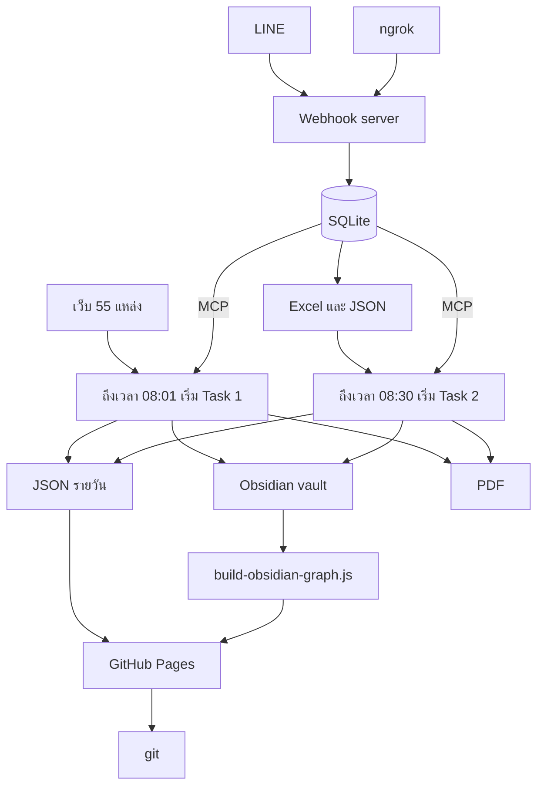
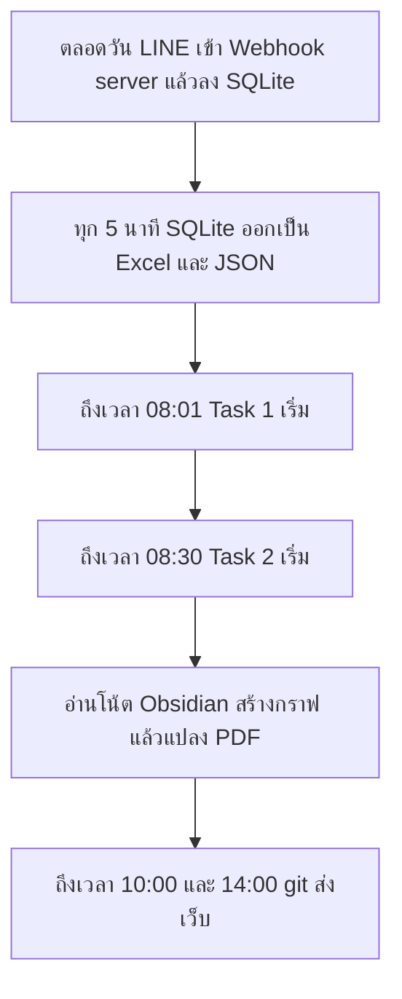
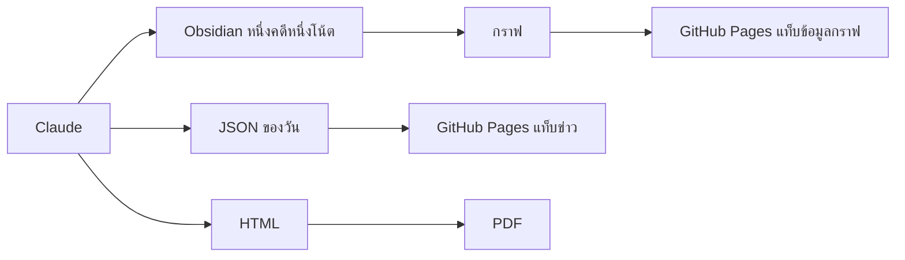

# ข่าวตำรวจ — ระบบรวบรวมและวิเคราะห์ข่าวรายวัน

ระบบนี้รับลิงก์ข่าวจากกลุ่ม LINE และกวาดเว็บตำรวจกับสื่อ แล้วให้ Claude วิเคราะห์ทีละหัวข่าวในรอบเดียวกัน จากนั้นแยกผลออกสามช่องทาง: เว็บสำหรับอ่าน, โน้ตสำหรับวิเคราะห์ภายใน, และ PDF สำหรับดาวน์โหลด

รายละเอียดเครื่องมือ ขั้นตอน และพารามิเตอร์อยู่ที่ [structure.md](structure.md) วิธีติดตั้งอยู่ที่ [docs/01-install-windows.md](docs/01-install-windows.md)

เวลาทั้งหมดด้านล่างเป็น Asia/Bangkok

## ภาพรวม

Obsidian อยู่กลางทาง กราฟบนเว็บอ่านโน้ตที่ Claude เขียนลง `vault/` ไม่ได้ข้าม Obsidian ไปสร้างกราฟเอง

| เครื่องมือ | บทบาท |
| --- | --- |
| LINE | กลุ่มที่ส่งลิงก์ข่าว |
| Webhook server | รับเหตุการณ์จาก LINE |
| ngrok | เปิดทางจากอินเทอร์เน็ตเข้าเครื่อง |
| SQLite | เก็บลิงก์และดัชนีค้นหา |
| Excel | ไฟล์ที่รอบเช้าเปิดอ่าน |
| MCP | ทางที่ Claude เรียก SQLite |
| WebFetch | เปิดหน้าเว็บ |
| source-fetcher | ตัวช่วยกวาดทีละชุดแหล่ง |
| Claude | วิเคราะห์และเขียนผล |
| Obsidian | โน้ตที่ Claude ต้องเขียน และเป็นต้นทางของกราฟบนเว็บ |
| PDF | รายงานดาวน์โหลด |
| GitHub Pages | เว็บที่คนอ่าน |
| git | ส่งไฟล์เว็บขึ้นเวลา 10:00 และ 14:00 |

## เวิร์กโฟลว์รายวัน

08:01 และ 08:30 เป็นเวลาที่ตั้งให้สองรอบเริ่ม ไม่ได้เป็นตารางงานที่เอาไฟล์ไปวาง เมื่อถึงเวลานั้น Claude เปิดรอบแล้วทำตามไฟล์ prompt ของรอบนั้น

1. ตลอดวัน LINE ส่งลิงก์เข้า Webhook server แล้วลง SQLite
2. ทุก 5 นาที SQLite ถูกเขียนออกเป็น `server/exports/line_intake_continuous.json` และ `.xlsx` ตอนรับลิงก์และตอนส่งออกจะตัดหางที่ติดจากข้อความ LINE เช่น `\n` `/n/n` `/n*2` `//n`
3. ถึง 08:01 Task 1 เริ่ม กวาดเว็บ 55 แหล่งตาม prompt ของ Task 1
4. ถึง 08:30 Task 2 เริ่ม อ่านลิงก์ของวันนี้ และลิงก์เมื่อวานที่ยังไม่ถูกประมวลผล จาก Excel ตาม prompt ของ Task 2
5. ท้ายรอบ Claude เขียนโน้ต Obsidian ก่อน สคริปต์จึงอ่านโน้ตนั้นไปทำกราฟบน GitHub Pages และแปลง PDF
6. 10:00 และ 14:00 git ส่งเว็บขึ้น GitHub Pages

เครื่องที่รัน Webhook server ต้องเปิดค้างไว้ งาน `NewsIntel-LineWebhook` ตรวจทุก 2 นาที และซ่อม ngrok เมื่อเซิร์ฟเวอร์ไม่ตอบ

## หนึ่งเรื่องออกสามช่องทาง

- **Obsidian** คือไฟล์ใน `vault/20_Cases/` ที่ prompt สั่งให้เขียนทุกหัวข่าวที่รอบนั้นแตะ แท็บข้อมูลกราฟอ่านกราฟที่แปลงจากโน้ตเหล่านี้ ตัวโฟลเดอร์โน้ตไม่ขึ้นเว็บ
- **GitHub Pages** อ่านข่าวจาก `feed.json` มีแท็บข่าว แท็บข้อมูลกราฟ และแท็บดาวน์โหลด
- **PDF** เป็นรายงานรวมของวัน แต่ละหัวมีภาพกราฟของเรื่องนั้น ตัวอักษรไทยใช้ฟอนต์ THSarabun

## สองรอบของ Claude

| | Task 1 | Task 2 |
| --- | --- | --- |
| เวลาที่ตั้งให้เริ่ม | 08:01 | 08:30 |
| ไฟล์ที่ทำตามเมื่อถึงเวลานั้น | `prompts/task-1-police-crime-news-pipeline.md` | `prompts/task-2-LINE-Message-Extract-crime-news.md` |
| แหล่ง | เว็บในบัญชี 55 แหล่ง แบ่งชุด A–D | URL จาก LINE ของวันนี้ และของเมื่อวานที่ `status` ยังเป็น `new` |
| ไฟล์เว็บ | `{วันที่}_crime.json` | `{วันที่}_crime_line.json` |
| โฟลเดอร์รายงาน | `Document/{วันที่}_Crime/` | `Document/{วันที่}_CrimeLine/` |

ทั้งสองรอบใช้กติกาเนื้อหาชุดเดียวกัน วิเคราะห์อยู่ในรอบนั้น และเขียนโน้ต Obsidian ในรอบนั้น ขั้นตอนย่อยที่ไฟล์ prompt สั่งไว้ อยู่ใน [structure.md](structure.md)

## กติกาที่ทั้งสองรอบยึด

- เปิดเว็บทางการก่อน แล้วจึงใช้สื่อยืนยัน หน้าโซเชียลเก็บเป็นที่อยู่อ้างอิงและไม่เปิด
- เปิด permalink ของข่าวแล้วอ่านเนื้อหาทั้งเรื่องจนจบก่อนสรุป ติดแท็ก หรือวิเคราะห์ เกณฑ์ 300 ตัวอักษรเป็นขั้นต่ำว่าหน้ามีเนื้อหา
- แท็กบนเว็บมี 1 ถึง 2 คำต่อข่าว เป็นเรื่องเฉพาะของหัวนั้น จังหวัด หน่วยงาน และจำนวนของกลางอยู่ในฟิลด์อื่น
- ลิงก์จาก LINE ถูกตัดหาง `\n` `/n/n` `/n*2` และ `//n` ก่อนเก็บ path จริงอย่าง `/n/breaking/` คงไว้
- หลายสำนักที่รายงานเหตุการณ์เดียวกันถูกรวมเป็นหนึ่งเรื่อง
- เส้นบนกราฟมีป้ายภาษาไทย โยงไปข่าวอื่นเมื่อเป็นเหตุการณ์เดียวกันหรือเป็นการติดตามผลที่ชี้ได้
- รหัสเรื่องเป็นรูปแบบ `20261026-drug-01` หนึ่งรหัสต่อหนึ่งเหตุการณ์
- รอบข่าวไม่สั่ง `git add` `git commit` หรือ `git push`

## เอกสารที่คู่กัน

| ไฟล์ | เนื้อหา |
| --- | --- |
| [structure.md](structure.md) | เครื่องมือ, agent, ขั้นตอนประมวลผล, กราฟ, API |
| [docs/01-install-windows.md](docs/01-install-windows.md) | ติดตั้งบน Windows |
| [docs/05-line-webhook-setup.md](docs/05-line-webhook-setup.md) | ตั้ง LINE, tunnel, และไฟล์รับเข้า |
| [prompts/](prompts/) | คำสั่งที่ Claude ทำตามเมื่อถึงเวลาของรอบนั้น |
