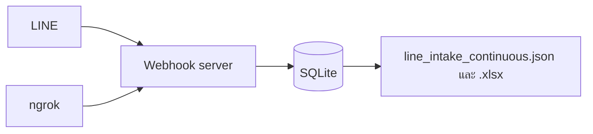
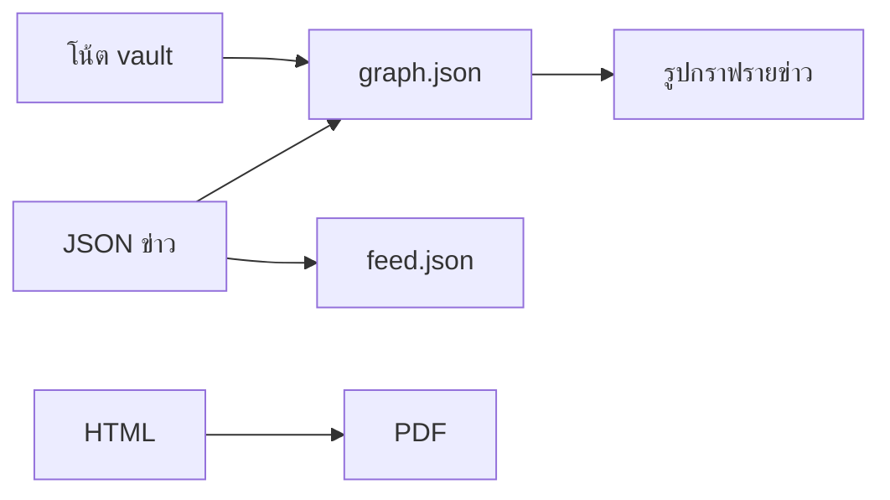
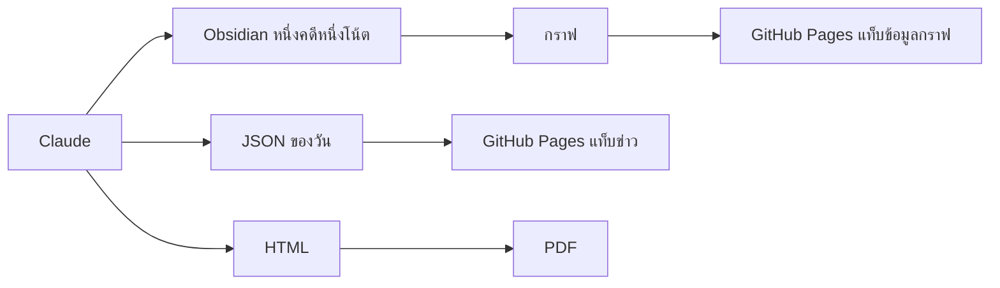

# ข่าวตำรวจ — ระบบรวบรวมและวิเคราะห์ข่าวรายวัน

ระบบนี้รับลิงก์ข่าวจากกลุ่ม LINE และกวาดเว็บตำรวจกับสื่อ แล้วให้ Claude วิเคราะห์ทีละหัวข่าวในรอบเดียวกัน จากนั้นแยกผลออกสามช่องทาง: เว็บสำหรับอ่าน, โน้ตสำหรับวิเคราะห์ภายใน, และ PDF สำหรับดาวน์โหลด

รายละเอียดเครื่องมือ ขั้นตอน และพารามิเตอร์อยู่ที่ [structure.md](structure.md) วิธีติดตั้งอยู่ที่ [docs/01-install-windows.md](docs/01-install-windows.md)

เวลาทั้งหมดด้านล่างเป็น Asia/Bangkok

## สามชั้น อย่าปนกัน

งานนี้มีสามชั้น คนละหน้าที่ ชั้นหลังไม่คิดข่าวแทน Claude และ skill ไม่ได้ถูกรันเป็นโปรแกรมหลังบ้าน

| ชั้น | ใครทำ | ทำอะไร |
| --- | --- | --- |
| 1. เก็บของเข้า | Webhook server และสคริปต์ส่งออก | รับลิงก์ LINE ลง SQLite แล้วเขียนไฟล์ให้รอบเช้าย่าน |
| 2. ทำข่าว | Claude ตามไฟล์ prompt ของรอบนั้น | อ่านบทความจนจบ แล้วเขียน JSON โน้ต Obsidian และ HTML |
| 3. ประกอบไฟล์เว็บ | สคริปต์ Node และ Python ที่รอบนั้นสั่งตอนปิดงาน | อ่านของที่ Claude เขียนเสร็จ แล้วทำ `feed.json` `graph.json` รูปกราฟ และ PDF |

skill เป็นไฟล์กติกาใน `plugin/news-intel/skills/` Claude อ่านเมื่อมีคนสั่ง `/crime-news` รอบ 08:01 และ 08:30 ไม่ได้เรียก skill เพิ่ม มันทำตามไฟล์ใน `prompts/` ทั้งไฟล์

## ข้อมูลกราฟมาจากไหน

แท็บข้อมูลกราฟมาจากโน้ต Obsidian ที่ Claude เขียนในชั้นที่ 2 ไม่ได้มีคนเปิดแอป Obsidian มาลากเส้น และไม่ได้มี skill ไปสร้างกราฟทีหลัง

1. Claude เขียน `vault/20_Cases/{รหัส}.md` และใส่เส้นในฟิลด์ `rel_units` `rel_people` `rel_projects` `rel_cases`
2. ตอนปิดรอบ Claude สั่ง `node ops/rebuild-pages-feed.js`
3. สคริปต์นั้นเรียก `build-obsidian-graph.js` ให้อ่านโน้ตใน `vault/` แล้วเขียน `github-pages/data/graph.json`
4. สคริปต์เดียวกันยังอ่าน JSON ข่าวที่ Claude เขียนไว้แล้ว เพื่อเติมเส้น `related_cases` และชื่อที่โค้ดเจอในเนื้อโพสต์ มันไม่เปิดเว็บใหม่และไม่วิเคราะห์ข่าวใหม่
5. `build-case-ego-graphs.js` ตัดกราฟก้อนนั้นเป็นรูปของแต่ละข่าว

โฟลเดอร์ `vault/` ไม่ขึ้นเว็บ เว็บอ่านแค่ `graph.json` กับรูปที่สคริปต์ประกอบแล้ว

## ชั้นที่ 1 เก็บลิงก์ตลอดวัน

1. เครื่องต้องเปิดค้าง งาน `NewsIntel-LineWebhook` ตรวจทุก 2 นาที และซ่อม ngrok เมื่อเซิร์ฟเวอร์ไม่ตอบ
2. ลิงก์ที่เข้ามาถูกตัดหาง `\n` `/n/n` `/n*2` `//n` ก่อนลง SQLite
3. ทุก 5 นาทีงาน `NewsIntel-LineExcel` เขียน `server/exports/line_intake_continuous.json` และ `.xlsx` Task 1 ไม่ได้ใช้สองไฟล์นี้

## ชั้นที่ 2 สองรอบของ Claude

แต่ละรอบเป็น session ใหม่ ถึงเวลาแล้ว Claude อ่าน prompt ของรอบนั้นแล้วทำตามลำดับในไฟล์ ไม่มีรอบข่าวภาครัฐแทรก

### Task 1 เริ่ม 08:01

ไฟล์คำสั่ง `prompts/task-1-police-crime-news-pipeline.md` แหล่งคือเว็บ 55 แหล่ง ชุด A ถึง D

1. เปิดหน้ารายการของแต่ละแหล่ง เก็บ permalink ที่อยู่ในหน้าต่างเมื่อวานถึงเวลารัน
2. เปิด permalink แบบ `rendered` อ่านเนื้อหาทั้งเรื่องจนจบ แล้วจึงสรุป ติดแท็ก และวิเคราะห์
3. รวมสำนักที่รายงานเหตุการณ์เดียวกันเป็นหนึ่งเรื่อง
4. เขียน `Document/{วันที่}_Crime/{วันที่}_crime.json` โน้ต `vault/20_Cases/` และ HTML
5. สั่งสคริปต์ชั้นที่ 3 ของรอบนี้

### Task 2 เริ่ม 08:30

ไฟล์คำสั่ง `prompts/task-2-LINE-Message-Extract-crime-news.md` แหล่งคือไฟล์ลิงก์จากชั้นที่ 1 ไม่กวาดเว็บ 55 แหล่งซ้ำ

1. โหลดลิงก์ของวันนี้ทั้งหมด และลิงก์เมื่อวานที่ `status` ยังเป็น `new`
2. ตัดโซเชียลและเรื่องที่ไม่ใช่คดีออกก่อนเปิดหน้า
3. เทียบกับข่าวที่ Task 1 เขียนไว้แล้ว URL เดิมข้าม เรื่องเดิมแนบลิงก์ เรื่องใหม่จึงเปิดบทความจนจบ
4. เขียน `{วันที่}_crime_line.json` และโน้ตของหัวที่รอบนี้แตะ ลิงก์เมื่อวานที่ยังไม่ทำเขียนเพิ่มในไฟล์ของเมื่อวาน
5. สั่งสคริปต์ชั้นที่ 3 ของรอบนี้

## ชั้นที่ 3 ประกอบเว็บ แล้วค่อยส่ง

ท้าย Task 1 และท้าย Task 2 เรียกสคริปต์ชุดเดียวกัน คนละไฟล์ผลของรอบตัวเอง 10:00 และ 14:00 งาน git จึงส่งไฟล์ที่ประกอบแล้วขึ้น GitHub Pages

## หนึ่งเรื่องออกสามช่องทาง

- **Obsidian** คือไฟล์ใน `vault/20_Cases/` ที่ prompt สั่งให้เขียนทุกหัวข่าวที่รอบนั้นแตะ แท็บข้อมูลกราฟอ่านกราฟที่แปลงจากโน้ตเหล่านี้ ตัวโฟลเดอร์โน้ตไม่ขึ้นเว็บ
- **GitHub Pages** อ่านข่าวจาก `feed.json` มีแท็บข่าว แท็บข้อมูลกราฟ และแท็บดาวน์โหลด
- **PDF** เป็นรายงานรวมของวัน แต่ละหัวมีภาพกราฟของเรื่องนั้น ตัวอักษรไทยใช้ฟอนต์ THSarabun

## สองรอบของ Claude

| | Task 1 | Task 2 |
| --- | --- | --- |
| เวลาที่ตั้งให้เริ่ม | 08:01 | 08:30 |
| ไฟล์ที่ทำตามเมื่อถึงเวลานั้น | `prompts/task-1-police-crime-news-pipeline.md` | `prompts/task-2-LINE-Message-Extract-crime-news.md` |
| แหล่ง | เว็บในบัญชี 55 แหล่ง แบ่งชุด A–D | URL จาก LINE ของวันนี้ และของเมื่อวานที่ `status` ยังเป็น `new` |
| ไฟล์เว็บ | `{วันที่}_crime.json` | `{วันที่}_crime_line.json` |
| โฟลเดอร์รายงาน | `Document/{วันที่}_Crime/` | `Document/{วันที่}_CrimeLine/` |

ทั้งสองรอบใช้กติกาเนื้อหาชุดเดียวกัน วิเคราะห์อยู่ในรอบนั้น และเขียนโน้ต Obsidian ในรอบนั้น ขั้นตอนย่อยที่ไฟล์ prompt สั่งไว้ อยู่ใน [structure.md](structure.md)

## กติกาที่ทั้งสองรอบยึด

- เปิดเว็บทางการก่อน แล้วจึงใช้สื่อยืนยัน หน้าโซเชียลเก็บเป็นที่อยู่อ้างอิงและไม่เปิด
- เปิด permalink ของข่าวแล้วอ่านเนื้อหาทั้งเรื่องจนจบก่อนสรุป ติดแท็ก หรือวิเคราะห์ เกณฑ์ 300 ตัวอักษรเป็นขั้นต่ำว่าหน้ามีเนื้อหา
- แท็กบนเว็บมี 1 ถึง 2 คำต่อข่าว เป็นเรื่องเฉพาะของหัวนั้น จังหวัด หน่วยงาน และจำนวนของกลางอยู่ในฟิลด์อื่น
- ลิงก์จาก LINE ถูกตัดหาง `\n` `/n/n` `/n*2` และ `//n` ก่อนเก็บ path จริงอย่าง `/n/breaking/` คงไว้
- หลายสำนักที่รายงานเหตุการณ์เดียวกันถูกรวมเป็นหนึ่งเรื่อง
- เส้นบนกราฟมีป้ายภาษาไทย โยงไปข่าวอื่นเมื่อเป็นเหตุการณ์เดียวกันหรือเป็นการติดตามผลที่ชี้ได้
- รหัสเรื่องเป็นรูปแบบ `20261026-drug-01` หนึ่งรหัสต่อหนึ่งเหตุการณ์
- รอบข่าวไม่สั่ง `git add` `git commit` หรือ `git push`

## เอกสารที่คู่กัน

| ไฟล์ | เนื้อหา |
| --- | --- |
| [structure.md](structure.md) | เครื่องมือ, agent, ขั้นตอนประมวลผล, กราฟ, API |
| [docs/01-install-windows.md](docs/01-install-windows.md) | ติดตั้งบน Windows |
| [docs/05-line-webhook-setup.md](docs/05-line-webhook-setup.md) | ตั้ง LINE, tunnel, และไฟล์รับเข้า |
| [prompts/](prompts/) | คำสั่งที่ Claude ทำตามเมื่อถึงเวลาของรอบนั้น |
