# ข่าวตำรวจ — ระบบรวบรวมและวิเคราะห์ข่าวรายวัน

ระบบนี้เก็บลิงก์จากกลุ่ม LINE ตลอดวัน และตอนเช้าให้ Claude กวาดเว็บตำรวจกับสื่อ แล้วอ่านข่าวทีละเรื่องจนจบ ผลของแต่ละเรื่องออกสามทาง: หน้าเว็บสำหรับอ่าน, โน้ตสำหรับเก็บความเชื่อมของคดี, และไฟล์ PDF สำหรับดาวน์โหลด

รายชื่อแหล่งข่าว 55 แห่ง ขั้นตอนย่อย และช่องเรียกฐานข้อมูลอยู่ใน [structure.md](structure.md) วิธีติดตั้งอยู่ที่ [docs/01-install-windows.md](docs/01-install-windows.md)

เวลาทั้งหมดเป็นเวลาประเทศไทย

## โครงสร้างระบบ

แผนภาพด้านล่างมาจาก [structure.md](structure.md) อ่านจากบนลงล่าง

### ลำดับของวัน

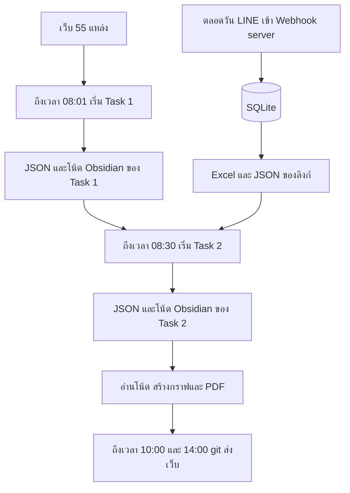

Task 1 กวาดเว็บเอง ไม่ได้รอไฟล์จาก LINE Task 2 ไม่กวาดเว็บ 55 แหล่ง มันเทียบลิงก์ของวันนี้ และลิงก์เมื่อวานที่สถานะยังเป็น `new` กับข่าวและโน้ตที่ Task 1 ทิ้งไว้

### สามชั้น อย่าปนงานกัน

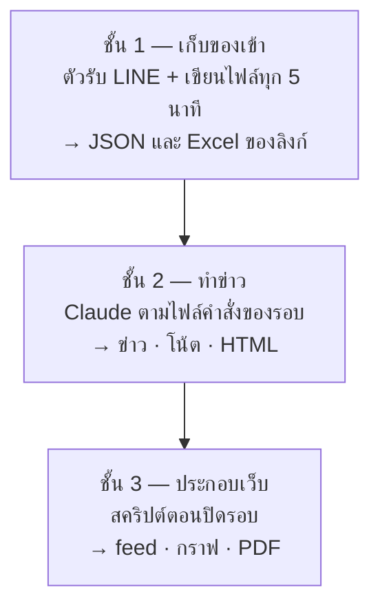

| ชั้น | เริ่มเมื่อ | ผลที่ทิ้งไว้ให้ชั้นถัดไป |
| --- | --- | --- |
| เก็บลิงก์ | ตลอดวัน | `server/exports/line_intake_continuous.json` และ `.xlsx` |
| Claude ทำข่าว | 08:01 Task 1 แล้ว 08:30 Task 2 | JSON รายวัน โน้ต `vault/` และ HTML |
| สคริปต์ประกอบเว็บ | ตอนปิดงานของรอบนั้น | `feed.json` `graph.json` รูปกราฟรายข่าว และ PDF |

ชั้นหลังไม่ไปเปิดเว็บแทนชั้นก่อน และไม่ได้คิดข่าวใหม่

### ไฟล์คำสั่งกับ skill

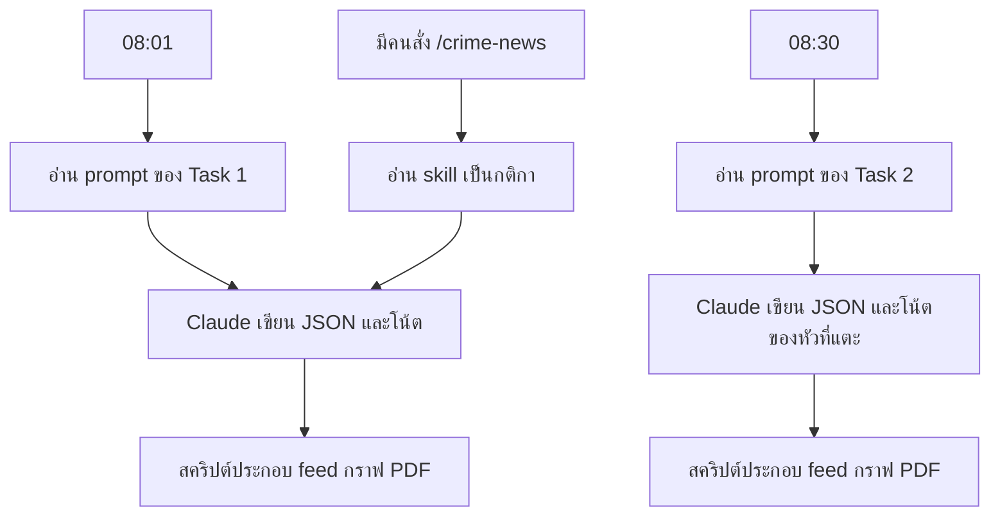

| รอบ | ไฟล์คำสั่ง | เมื่อถึงเวลาที่ตั้งไว้ |
| --- | --- | --- |
| Task 1 | `prompts/task-1-police-crime-news-pipeline.md` | 08:01 เริ่มกวาดเว็บ |
| Task 2 | `prompts/task-2-LINE-Message-Extract-crime-news.md` | 08:30 เริ่มจากลิงก์ LINE |
| เรียกด้วยมือ | skill ใน `plugin/news-intel/skills/` | มีคนสั่ง `/crime-news` |

### โฟลเดอร์หลัก

```
prompts/                 ไฟล์คำสั่งรอบ 08:01 และ 08:30
plugin/news-intel/       skills และ agent source-fetcher
server/                  Webhook, SQLite, MCP
vault/                   โน้ต Obsidian ต้นทางของกราฟ
Document/                ผล Task 1 และ Task 2 รายวัน
github-pages/            เว็บที่อ่าน feed และ graph
ops/                     สคริปต์ปิดงานและส่งเว็บ
```

## เครื่องมือ

| เครื่องมือ | หน้าที่ |
| --- | --- |
| Webhook server (`server/`) | รับเหตุการณ์จาก LINE เก็บลิงก์ลง SQLite |
| ngrok | เปิดทางให้ LINE จากอินเทอร์เน็ตเรียกเข้าเครื่อง |
| SQLite | เก็บลิงก์ สถานะรอบ และดัชนีข่าวเก่า |
| MCP (`mcp-stdio.ts`) | ช่องที่ Claude ถามสถานะรอบ ลิงก์ และข่าวเก่า |
| Claude + ไฟล์ใน `prompts/` | อ่านข่าว วิเคราะห์ เขียน JSON โน้ต และ HTML ตามรอบ |
| `source-fetcher` | ผู้ช่วยที่ Task 1 ส่งไปกวาดทีละชุดแหล่งด้วย WebSearch / WebFetch |
| Windows Task Scheduler | ตั้งเวลา webhook, ส่งออกไฟล์ลิงก์, รอบเช้า, และส่งเว็บ |
| สคริปต์ใน `ops/` | ประกอบ feed กราฟ PDF และส่งขึ้น GitHub Pages |
| GitHub Pages (`github-pages/`) | หน้าเว็บที่อ่าน `feed.json` และ `graph.json` |

| งาน Windows | จังหวะ | สคริปต์ |
| --- | --- | --- |
| `NewsIntel-LineWebhook` | ทุก 2 นาที | `ops/ensure-line-webhook.ps1` |
| `NewsIntel-LineExcel` | ทุก 5 นาที | `ops/export-line-continuous.ps1` |
| รอบ Task 1 | 08:01 | `prompts/task-1-police-crime-news-pipeline.md` |
| รอบ Task 2 | 08:30 | `prompts/task-2-LINE-Message-Extract-crime-news.md` |
| `NewsIntel-GitPublish-Morning` | 10:00 | `ops/git-publish-pages.ps1` |
| `NewsIntel-GitPublish-Afternoon` | 14:00 | `ops/git-publish-pages.ps1` |

## ขั้นตอนการทำงาน

1. ตลอดวัน กลุ่ม LINE ส่งลิงก์ → Webhook เก็บลง SQLite (ngrok ค้างทางเข้าเครื่อง)
2. ทุก 5 นาที ส่งออก `server/exports/line_intake_continuous.json` และ Excel คู่กัน
3. 08:01 Claude ทำตาม Task 1 — กวาด 55 แหล่ง อ่านจนจบ เขียนข่าว โน้ต รายงาน แล้วรันสคริปต์ประกอบเว็บ
4. 08:30 Claude ทำตาม Task 2 — อ่านไฟล์ลิงก์จากขั้น 2 เทียบกับผลเช้า เปิดเฉพาะเรื่องใหม่ แล้วประกอบเว็บอีกรอบ
5. 10:00 และ 14:00 สคริปต์ rebuild แล้ว push ขึ้น GitHub Pages

รายละเอียดขั้นย่อยของแต่ละรอบอยู่ใน [structure.md](structure.md)

## ชั้นที่ 1 เก็บลิงก์ตลอดวัน

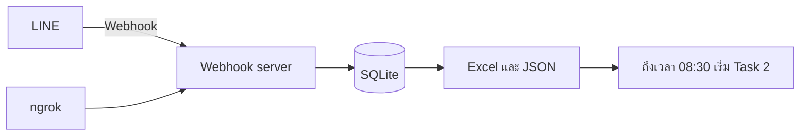

1. เครื่องต้องเปิดค้าง งาน `NewsIntel-LineWebhook` ตรวจทุก 2 นาที ถ้าตัวรับไม่ตอบจะซ่อมทางเข้าเครื่อง
2. รับเฉพาะกลุ่มที่อนุญาต ไม่เก็บชื่อคนส่ง และไม่เก็บข้อความที่ไม่มีลิงก์
3. ลิงก์ที่ติดหางจากข้อความ เช่น ขึ้นบรรทัดใหม่ หรือ `/n*2` ถูกตัดออกก่อนเก็บ ส่วนทางอย่าง `/n/breaking/` ของเว็บข่าวไม่ถูกตัด
4. เฟซบุ๊ก ติ๊กต็อก ยูทูบ และโซเชียลอื่นถูกเก็บไว้แต่ทำเครื่องหมายว่าเปิดเป็นข่าวไม่ได้
5. ทุก 5 นาทีงาน `NewsIntel-LineExcel` เขียน `server/exports/line_intake_continuous.json` และไฟล์ Excel คู่กัน รอบกวาดเว็บไม่ได้ใช้สองไฟล์นี้

## ชั้นที่ 2 สองรอบเช้า

### รอบกวาดเว็บ เริ่ม 08:01 — สิบขั้น

ไฟล์คำสั่งคือ `prompts/task-1-police-crime-news-pipeline.md` แหล่งข่าวคือเว็บตำรวจ หน่วยยุติธรรม สื่อไทยหมวดอาชญากรรม และสื่อภาษาอังกฤษที่เกี่ยวกับไทย รวม 55 แหล่ง แบ่งสี่ชุด เปิดหน่วยทางการก่อนสื่อ รายชื่อแต่ละแหล่งอยู่ใน [structure.md](structure.md)

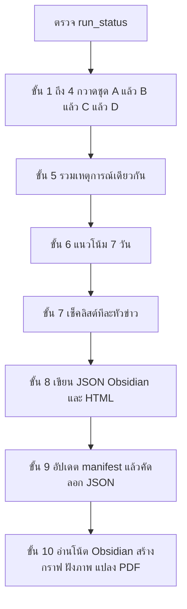

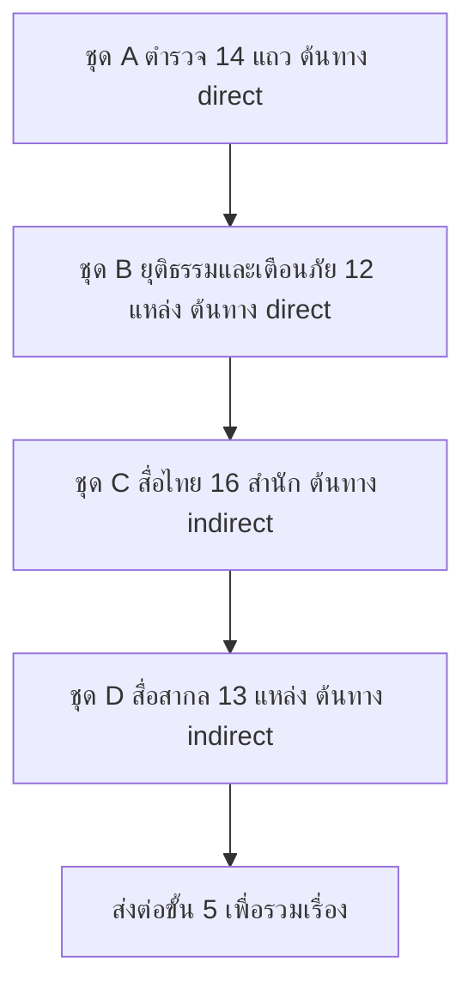

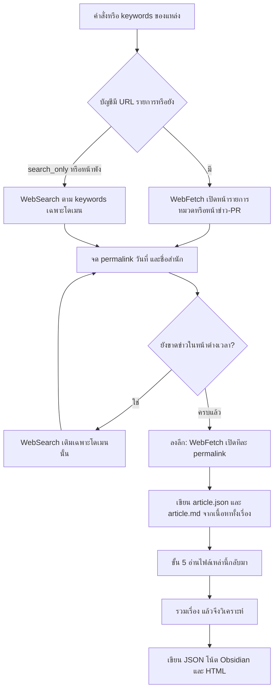

หน้าต่างข่าวคือตั้งแต่เที่ยงคืนของเมื่อวานจนถึงเวลาที่รอบเริ่ม ข่าวที่เหตุเกิดก่อนหน้านั้นแต่เพิ่งเผยแพร่ในช่วงนี้เก็บได้ ข่าวต่างประเทศที่ไม่เกี่ยวกับไทยไม่เก็บ

1. ตรวจว่ารอบวันนี้ทำจบแล้วหรือยัง ถ้าจบแล้วและไม่มีคำสั่งให้ทำซ้ำ ให้หยุด
2. เปิดหน้ารายการของแต่ละแหล่ง เก็บลิงก์ข่าวที่อยู่ในหน้าต่างเวลา แหล่งที่ไม่มีหน้าเว็บให้ค้นเฉพาะโดเมนนั้น
3. เปิดลิงก์ของข่าวแต่ละชิ้นให้เนื้อหาโหลดครบ อ่านจนจบเรื่อง แล้วจึงสรุปและติดแท็ก 300 ตัวอักษรเป็นแค่เกณฑ์ว่าหน้ามีเนื้อหา ไม่ใช่จุดให้หยุดอ่าน
4. เขียนไฟล์ข่าวทันที เพื่อให้ขั้นถัดไปอ่านกลับมาได้ ไม่ต้องจำหน้าเว็บทั้งก้อน
5. รวมสำนักที่รายงานเหตุการณ์เดียวกันเป็นหนึ่งเรื่อง แหล่งทางการเป็นลิงก์หลัก แหล่งอื่นเป็นแหล่งประกอบ
6. เทียบจำนวนข่าวกับ 7 วันก่อน ถ้าข้อมูลย้อนหลังไม่พอ จะไม่สรุปว่าข่าวประเภทนั้นพุ่งขึ้น
7. วิเคราะห์ทีละหัว ใส่หน่วย สถานที่ บุคคล และเส้นภาษาไทย ก่อนโยงไปข่าวอื่นต้องค้นข่าวเก่าในฐานข้อมูลก่อน
8. เขียนข่าวของวัน โน้ตหนึ่งเรื่องต่อหนึ่งไฟล์ และหน้ารายงาน
9. คัดลอกไฟล์ข่าวไปโฟลเดอร์เว็บ และเติมสารบัญของวัน
10. สั่งสคริปต์ประกอบรายการข่าว กราฟ และ PDF ของรอบนี้ รอบนี้ไม่สั่งส่งขึ้น GitHub

| ชุด | คืออะไร | จำนวน |
| --- | --- | --- |
| A | เว็บหน่วยตำรวจและหน้าประชาสัมพันธ์ | 14 แถว |
| B | ยุติธรรม บังคับใช้กฎหมาย และหน่วยเตือนภัย | 12 แหล่ง |
| C | สื่อไทยหมวดอาชญากรรม | 16 สำนัก |
| D | สื่อภาษาอังกฤษและองค์กรระหว่างประเทศ เฉพาะที่เกี่ยวกับไทย | 13 แหล่ง |

ข่าวภาษาอังกฤษถูกเขียนสรุปเป็นภาษาไทย ฟอรัมใช้เป็นเบาะแสเท่านั้น ต้องมีแหล่งอื่นยืนยันก่อนทำเป็นข่าว โซเชียลไม่ถูกเปิด ถ้าสื่ออ้างโพสต์เฟซบุ๊ก ให้เปิดบทความของสื่อนั้น

### รอบลิงก์จาก LINE เริ่ม 08:30 — สิบสองขั้น

ไฟล์คำสั่งคือ `prompts/task-2-LINE-Message-Extract-crime-news.md` รอบนี้ไม่กวาดเว็บ 55 แหล่งซ้ำ มันอ่านไฟล์ลิงก์จากชั้นที่ 1 แล้วเทียบกับข่าวที่รอบ 08:01 เขียนไว้แล้ว

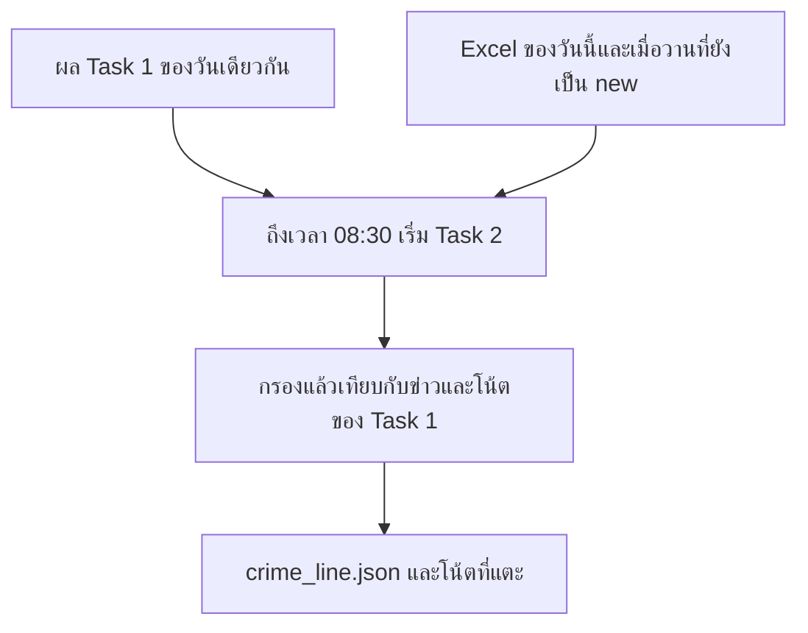

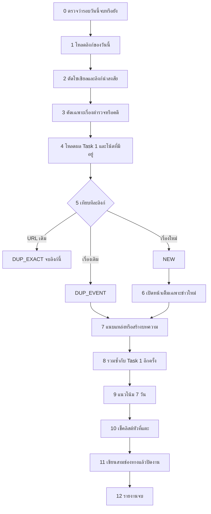

ถ้ารอบนี้เคยจบไปแล้ว แต่ยังมีลิงก์เมื่อวานที่ยังไม่ได้ทำ ให้ทำต่อ

1. โหลดลิงก์ของวันนี้ทั้งหมด และลิงก์เมื่อวานที่สถานะยังเป็นยังไม่ได้ทำ ลิงก์เมื่อวานที่ทำแล้วหรือถูกข้ามแล้วไม่นำกลับมา
2. ตัดโซเชียล วิดีโอสั้น และลิงก์ที่เปิดไม่ได้ ออกก่อนเปิดหน้า
3. คัดให้เหลือเรื่องตำรวจ คดี หรือประชาสัมพันธ์ของตำรวจ ท่อนสั้นใช้ตัดสินเก็บหรือทิ้งเท่านั้น ยังไม่ใช้เขียนข่าว
4. เปิดข่าวและโน้ตที่มีอยู่ของวันนี้และของเมื่อวาน เพื่อกันเรื่องซ้ำ
5. แยกสามทาง ลิงก์เดิมที่มีอยู่แล้วข้าม คนละลิงก์แต่เรื่องเดิมให้นำไปแนบ เรื่องใหม่ให้นำไปเปิด
6. เปิดเฉพาะเรื่องใหม่ให้เนื้อหาโหลดครบ อ่านจนจบก่อนเขียนข่าว
7. เรื่องใหม่ได้ข่าวใหม่หนึ่งชิ้น แท็ก 1 ถึง 2 คำ เรื่องเดิมได้แค่ลิงก์เพิ่ม ไม่เขียนเนื้อหาทั้งก้อนทับ
8. รวมซ้ำอีกรอบกับผลของรอบเช้า
9. เทียบแนวโน้ม 7 วันเมื่อมีข่าวใหม่หรือมีการแนบแหล่ง
10. วิเคราะห์เฉพาะหัวที่รอบนี้แตะ ด้วยเช็กลิสต์เดียวกับรอบเช้า
11. เขียนไฟล์ของรอบนี้ แล้วประกอบกราฟและ PDF ลิงก์เมื่อวานที่ยังไม่ได้ทำถูกเขียนเพิ่มในไฟล์ของเมื่อวาน
12. สรุปจำนวนที่ใช้และจำนวนที่ข้าม รอบนี้ไม่สั่งส่งขึ้น GitHub

## ข้อมูลกราฟมาจากไหน

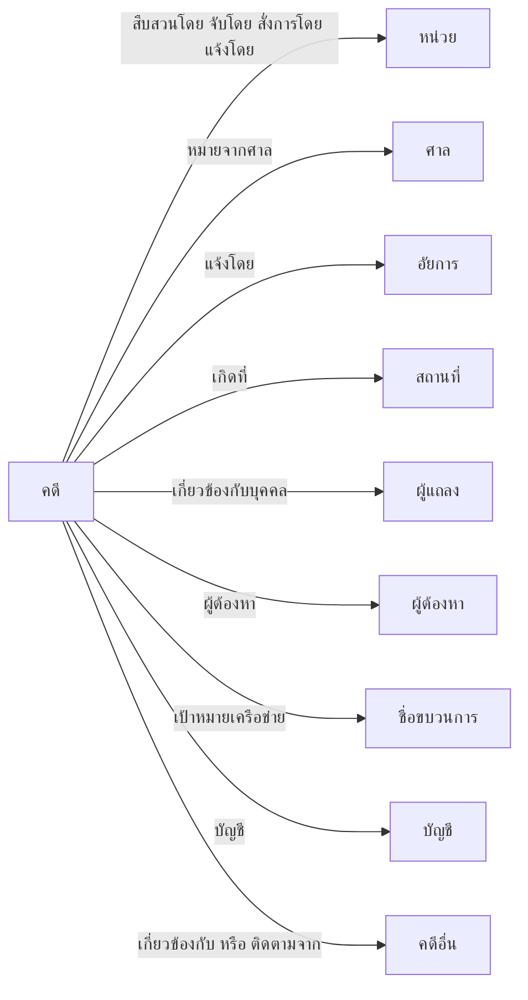

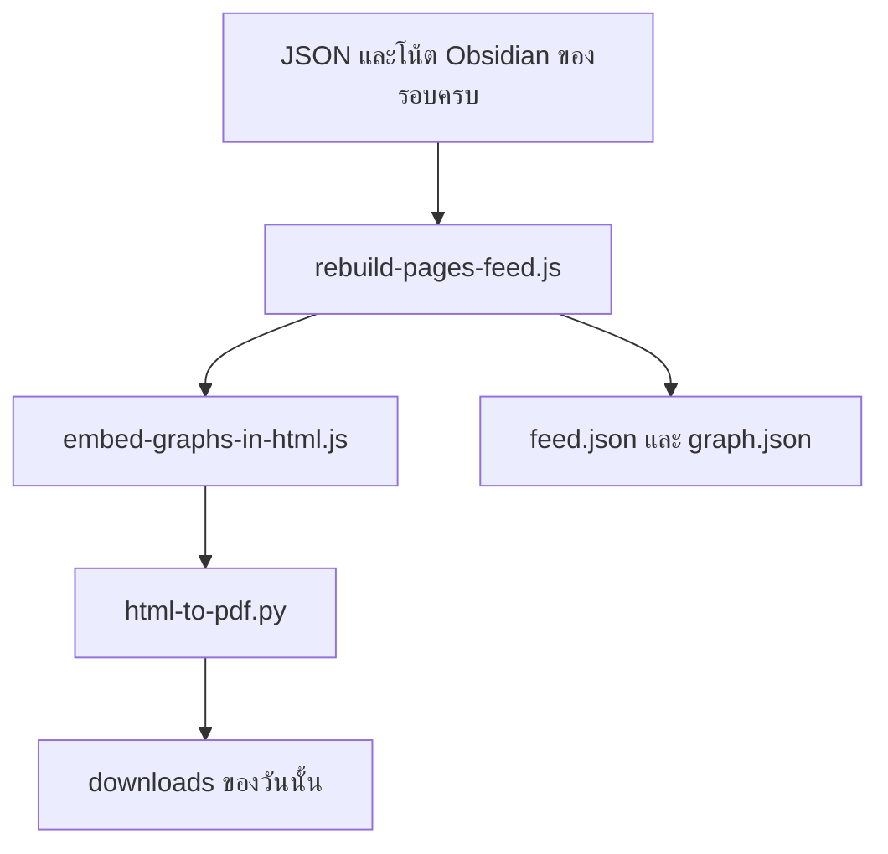

แท็บข้อมูลกราฟไม่ได้มีคนเปิดโปรแกรมโน้ตมาลากเส้น และไม่ได้มี skill ไปสร้างกราฟทีหลัง

1. Claude เขียนโน้ตหนึ่งเรื่องต่อหนึ่งไฟล์ใน `vault/20_Cases/` และใส่เส้นเป็นภาษาไทยว่าหน่วยไหนทำอะไร เกิดที่ไหน เกี่ยวกับใคร และโยงข่าวเก่าเรื่องไหน
2. ตอนปิดรอบ Claude สั่ง `node ops/rebuild-pages-feed.js`
3. สคริปต์ `build-obsidian-graph.js` อ่านโน้ตเหล่านั้นเป็นโครงหลัก แล้วอ่านไฟล์ข่าวที่เขียนเสร็จแล้วเพื่อเติมเส้นที่ Claude ใส่ไว้ในข่าว จากนั้นเขียน `github-pages/data/graph.json`
4. สคริปต์ `build-case-ego-graphs.js` ตัดกราฟก้อนนั้นเป็นรูปของแต่ละข่าว สำหรับหน้ารายข่าวและ PDF

สคริปต์ไม่เปิดเว็บข่าวใหม่และไม่วิเคราะห์ใหม่ ถ้ายังไม่มีโน้ต กราฟจะว่างเพราะสคริปต์ไม่สร้างโน้ตให้เอง โฟลเดอร์โน้ตไม่ขึ้นเว็บ เว็บอ่านแค่ไฟล์กราฟที่ประกอบแล้ว

ฐานข้อมูลยังมีดัชนีข่าวเก่าชื่อ `brain_search` ใช้ตอน Claude กำลังตัดสินใจว่าจะโยงข่าวหรือไม่ ดัชนีนี้ไม่ใช่กราฟที่คนเปิดบนเว็บ

## สามทางของหนึ่งเรื่อง

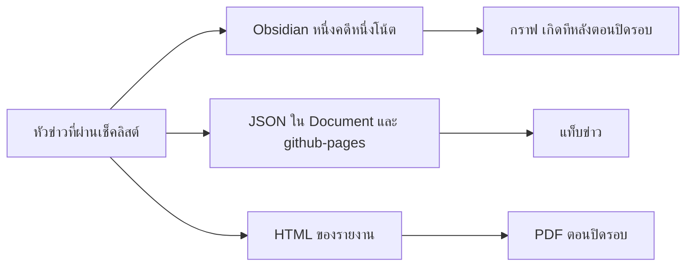

| ทาง | ไฟล์ | คนอ่านเห็นที่ไหน |
| --- | --- | --- |
| ข่าว | `{วันที่}_crime.json` ของรอบเช้า และ `{วันที่}_crime_line.json` ของรอบ LINE | แท็บข่าว อ่านจาก `feed.json` |
| โน้ต | `vault/20_Cases/{รหัส}.md` | ไม่ขึ้นเว็บ เป็นต้นทางของกราฟ |
| รายงาน | HTML แล้วแปลงเป็น PDF ตัวอักษรไทยใช้ฟอนต์ THSarabun | แท็บดาวน์โหลด |

### หลังทั้งสองรอบ — ส่งเว็บ

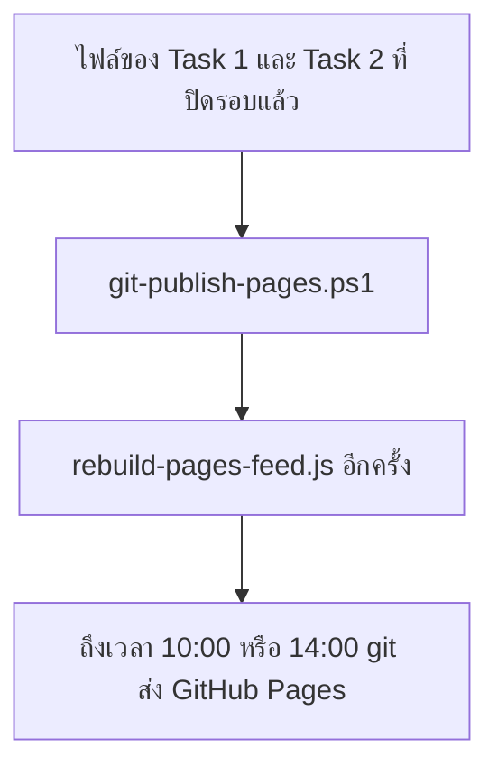

หน้าเว็บ

| สิ่งที่เปิด | ที่อยู่ |
| --- | --- |
| ข่าวทั้งหมด | `#/r/all` |
| ข่าวย้อนหลัง 1, 3, 7, 14, 30, 90 วัน | `#/r/1` `#/r/3` `#/r/7` `#/r/14` `#/r/30` `#/r/90` |
| ข่าวหนึ่งเรื่อง | `#/{วันที่}/{รหัสเรื่อง}` |
| ข้อมูลกราฟ | `#/brain` |
| ดาวน์โหลด | `#/downloads/r/all` |

## กติกาที่ใช้ทั้งสองรอบ

- เปิดเว็บทางการก่อน แล้วจึงใช้สื่อยืนยัน โซเชียลเก็บเป็นที่อยู่อ้างอิงและไม่เปิด
- อ่านเนื้อหาข่าวทั้งเรื่องก่อนสรุป ติดแท็ก หรือวิเคราะห์
- หลายสำนักที่เล่าเหตุการณ์เดียวกันถูกรวมเป็นหนึ่งเรื่อง ถือว่าเรื่องเดียวกันเมื่อตรงกันอย่างน้อย 3 ใน 4 ข้อ คือจังหวัด วันเกิดเหตุหรือวันจับ ประเภทคดี และตัวเลขหรือผู้ต้องหาที่สำคัญ
- แท็กบนเว็บมี 1 ถึง 2 คำต่อข่าว เป็นเรื่องเฉพาะของหัวนั้น เช่น ชื่อกลโกงหรือชื่อเว็บ ไม่ใส่จังหวัด ชื่อหน่วย หรือจำนวนของกลาง ช่องกรองประเภทใช้ชื่อประเภทภาษาไทย
- ชื่อชนิดยาใช้คำชนิดอย่างเดียว เช่น ยาบ้า ไม่ใส่จำนวนเม็ด
- เส้นบนกราฟเป็นภาษาไทย โยงข่าวอื่นเมื่อเป็นเรื่องเดียวกันหรือเป็นการติดตามผลที่ชี้ได้
- รหัสเรื่องเป็นแบบ `20261026-drug-01` หนึ่งรหัสต่อหนึ่งเหตุการณ์
- ข่าวภาษาอังกฤษถูกเขียนเป็นภาษาไทย
- ใช้คำว่าผู้ต้องหาหรือตามที่ตำรวจแถลง ไม่สรุปว่าผิดก่อนศาลพิพากษา และไม่เปิดชื่อผู้เสียหายในคดีเพศ ค้ามนุษย์ เด็ก หรือความรุนแรงในครอบครัว
- รอบข่าวไม่สั่ง `git add` `git commit` หรือ `git push` การส่งเว็บเป็นงาน 10:00 และ 14:00 แยกต่างหาก

## เอกสารที่อ่านต่อ

| ไฟล์ | เนื้อหา |
| --- | --- |
| [structure.md](structure.md) | รายชื่อ 55 แหล่ง ขั้นย่อยของทั้งสองรอบ และช่องถามฐานข้อมูล |
| [docs/01-install-windows.md](docs/01-install-windows.md) | ติดตั้งบน Windows |
| [docs/05-line-webhook-setup.md](docs/05-line-webhook-setup.md) | ตั้งกลุ่ม LINE ทางเข้าเครื่อง และไฟล์รับลิงก์ |
| [prompts/](prompts/) | ไฟล์คำสั่งที่รอบ 08:01 และ 08:30 ทำตาม |
