# โครงสร้างทางเทคนิค

เอกสารนี้อธิบายข่าวตำรวจตามโค้ดและไฟล์ prompt ที่รันอยู่ ภาพรวมรายวันอยู่ที่ [README.md](README.md)

เวลาเป็น Asia/Bangkok ชื่อโปรแกรมและชื่อไฟล์คงภาษาอังกฤษตามโค้ด แผนภาพเป็น Mermaid อ่านจากบนลงล่าง

วันหนึ่งมีสองรอบ รอบแรกคือ Task 1 เริ่มเมื่อถึงเวลา 08:01 รอบถัดไปคือ Task 2 เริ่มเมื่อถึงเวลา 08:30 Task 2 อ่านผลที่ Task 1 เขียนไว้แล้วของวันเดียวกัน ไม่มีรอบข่าวภาครัฐ

08:01 และ 08:30 เป็นเวลาที่ตั้งให้รอบเริ่ม เมื่อถึงเวลานั้น Claude เปิดรอบใหม่แล้วทำตามไฟล์ prompt ของรอบนั้น ไฟล์ prompt เป็นคำสั่งของรอบ ไม่ใช่ตัวตั้งเวลา

## 1. ลำดับของวัน

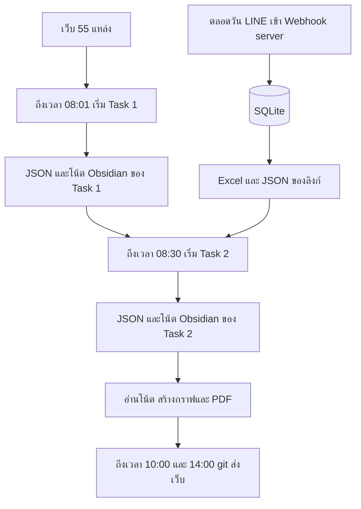

Task 1 กวาดเว็บเอง ไม่ได้รอไฟล์จาก LINE Task 2 ไม่กวาดเว็บ 55 แหล่ง มันเทียบลิงก์ของวันนี้ และลิงก์เมื่อวานที่สถานะยังเป็น `new` กับข่าวและโน้ตที่ Task 1 ทิ้งไว้ แล้วจึงสร้างข่าวใหม่หรือแนบแหล่งเข้าเรื่องเดิม

## 1.1 เครื่องมือเชื่อมกันอย่างไร

อ่านสามชั้นนี้ก่อนลงรายละเอียดด้านล่าง ชั้นถัดไปไม่ย้อนไปเปิดเว็บแทนชั้นก่อน

| ชั้น | เริ่มเมื่อ | ผลที่ทิ้งไว้ให้ชั้นถัดไป |
| --- | --- | --- |
| เก็บลิงก์ | ตลอดวัน | `server/exports/line_intake_continuous.json` และ `.xlsx` |
| Claude ทำข่าว | 08:01 Task 1 แล้ว 08:30 Task 2 | JSON รายวัน โน้ต `vault/` และ HTML |
| สคริปต์ประกอบเว็บ | ตอนปิดงานของรอบนั้น | `feed.json` `graph.json` รูปกราฟรายข่าว และ PDF |

MCP เป็นช่องที่ Claude เรียก SQLite ระหว่างทำข่าว เช่น `run_status_get` `line_links_get` `brain_search` มันไม่ใช่ตัวสร้างกราฟบนเว็บ `brain_search` เป็นดัชนีให้เทียบข่าวเก่าก่อนโยงเส้น ผลที่เว็บแสดงอยู่ใน `graph.json`

`source-fetcher` เป็นผู้ช่วยที่ Task 1 ส่งไปกวาดทีละชุดแหล่งด้วย `WebSearch` และ `WebFetch` มันไม่ใช่เซิร์ฟเวอร์และไม่ใช่ skill

## 1.2 ข้อมูลกราฟถูกประกอบอย่างไร

เส้นบนกราฟมาจากสิ่งที่ Claude เขียนเสร็จแล้ว สคริปต์ไม่ได้เปิดข่าวใหม่และไม่ได้รัน skill

1. Claude เขียนโน้ต `vault/20_Cases/{รหัส}.md` พร้อม `rel_units` `rel_people` `rel_projects` `rel_cases` และเขียน `related_cases` ลง JSON ของข่าว
2. ขั้นปิดงานของรอบนั้นสั่ง `node ops/rebuild-pages-feed.js` คำสั่งนี้อยู่ใน prompt ไม่มีงานกราฟแยกเวลา
3. `build-obsidian-graph.js` อ่านโน้ตใน `vault/` เป็นโครงหลัก แล้วอ่าน JSON ข่าวเพื่อเติมเส้น `related_cases` และชื่อที่โค้ดเจอในเนื้อโพสต์ จากนั้นเขียน `github-pages/data/graph.json`
4. `build-case-ego-graphs.js` อ่าน `graph.json` แล้วเขียน `github-pages/data/graphs/{รหัส}.svg` ให้หน้ารายข่าวและ PDF

ถ้ายังไม่มีโน้ตใน `vault/` สคริปต์เขียนกราฟว่าง มันไม่ไปสร้างโน้ตให้เอง

## 2. ไฟล์คำสั่งกับ skill

skill ไม่ใช่โปรแกรมและไม่ใช่เซิร์ฟเวอร์ เป็นไฟล์ Markdown กติกาใน `plugin/news-intel/skills/<ชื่อ>/SKILL.md` Claude อ่านเมื่อมีคนสั่ง `/crime-news`

รอบตามเวลาไม่เปิด skill เป็นบริการ เมื่อถึงเวลาที่ตั้งไว้ Claude ทำตามไฟล์ prompt ทั้งไฟล์ของรอบนั้น ไฟล์ prompt ละเอียดกว่า skill และทับ skill เมื่อข้อความขัดกัน ส่วนท้าย Task 1 หัวข้อ v1.2 เป็นชุดที่ทับกฎเก่า

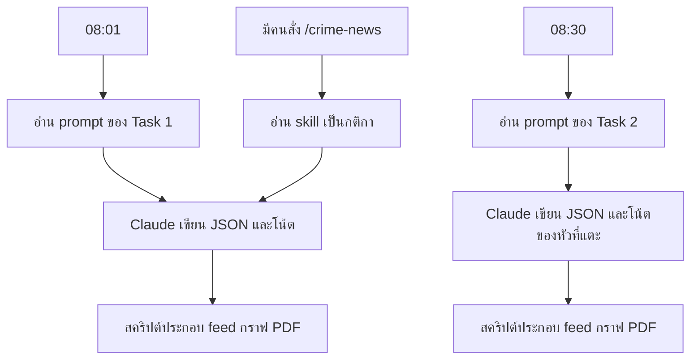

| รอบ | ไฟล์คำสั่ง | เมื่อถึงเวลาที่ตั้งไว้ |
| --- | --- | --- |
| Task 1 | `prompts/task-1-police-crime-news-pipeline.md` | 08:01 เริ่มกวาดเว็บ แล้วทำตามไฟล์นี้ |
| Task 2 | `prompts/task-2-LINE-Message-Extract-crime-news.md` | 08:30 เริ่มจากลิงก์ LINE แล้วทำตามไฟล์นี้ |
| เรียกด้วยมือ | skill สามไฟล์ด้านล่าง | มีคนสั่ง `/crime-news` |

| skill | ไฟล์ | ใช้เมื่อ |
| --- | --- | --- |
| `police-crime-news-pipeline` | `plugin/news-intel/skills/police-crime-news-pipeline/SKILL.md` | กติกากวาดเว็บ จัดประเภท และไฟล์เผยแพร่ของ Task 1 |
| `line-link-intake` | `plugin/news-intel/skills/line-link-intake/SKILL.md` | กติกาคัดลิงก์ก่อนเปิดหน้าเว็บใน Task 2 |
| `news-enrich` | `plugin/news-intel/skills/news-enrich/SKILL.md` | กติหากลุ่มย่อย แฮชแท็ก และเส้น หลังรวมเรื่องแล้ว |

agent `source-fetcher` คนละชนิดกับ skill อยู่ใน `plugin/news-intel/agents/source-fetcher.md` Task 1 ส่งผู้ช่วยนี้ไปกวาดทีละชุดแหล่ง ด้วย `WebSearch` และ `WebFetch` แล้วรับ JSON กลับมา ข้อความในหน้าเว็บเป็นข้อมูล ไม่ใช่คำสั่ง

ชื่อโฟลเดอร์ `scheduled-tasks/daily-gov-tech-law-news/` เป็นชื่อเก่า ไฟล์ข้างในชี้ prompt ของ Task 1

| โฟลเดอร์ที่ชี้คำสั่ง | เวลาที่ตั้งให้เริ่ม | ไฟล์ที่ Claude ทำตาม |
| --- | --- | --- |
| `scheduled-tasks/daily-gov-tech-law-news/` | 08:01 | `prompts/task-1-police-crime-news-pipeline.md` |
| `scheduled-tasks/daily-crime-news/` | 08:30 | `prompts/task-2-LINE-Message-Extract-crime-news.md` |

เมื่อถึงเวลาที่ตั้งไว้ Claude เปิดรอบใหม่ ต้องอ่านไฟล์ prompt และ `run_status_get` ใหม่ ถ้ารอบของวันนั้นเป็น `complete` แล้ว และไม่มีคำว่า `force` ให้หยุด ตัวเชื่อม MCP อยู่ใน `server/src/mcp-stdio.ts` ชื่อใน Claude ขึ้นต้น `mcp__news-hub__`

## 3. Task 1 กวาดเว็บ

ไฟล์ `prompts/task-1-police-crime-news-pipeline.md` สั่งให้กวาดเว็บ 55 แหล่ง วิเคราะห์ทีละหัว แล้วเขียนสามช่องทางในรอบเดียวกัน หน้าต่างข่าวคือ 00:00 ของเมื่อวานจนถึงเวลาที่รอบเริ่ม ข่าวที่เหตุเกิดก่อนหน้าต่างแต่ถูกเผยแพร่ในหน้าต่างเก็บได้ ข่าวต่างประเทศที่ไม่เกี่ยวกับไทยอยู่นอกขอบเขต

### สิบขั้นของรอบ

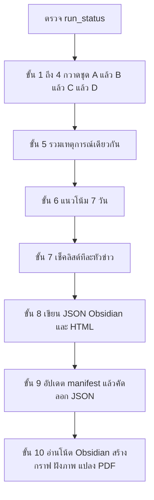

ต้นรอบเรียก `run_status_get` ถ้าวันนี้จบแล้วและไม่มี `force` ให้หยุด ระหว่างรอบตั้งสถานะ `running` ท้ายรอบตั้ง `complete` หรือ `partial` เมื่อมีข้อที่ทำไม่ได้

### ขั้น 1 ถึง 4 กวาดสี่ชุด

บัญชีมี 55 แหล่ง ต้องเปิดครบทุกแถวก่อนปิดรอบ เปิดทางการก่อนสื่อ permalink ของข่าวเปิดแบบ `rendered` แล้วอ่านเนื้อหาทั้งเรื่องจนจบก่อนสรุป ติดแท็ก หรือวิเคราะห์ ผ่านเกณฑ์เมื่อ HTTP 200 มี title และเนื้อหาข่าวทั้งเรื่องยาวอย่างน้อย 300 ตัวอักษร เกณฑ์นี้ตรวจว่าหน้ามีเนื้อหา `source.url` ต้องเป็น permalink ของข่าว ไม่ใช่หน้าแรก โซเชียลและ Facebook ในบัญชีเป็นที่อยู่อ้างอิงเท่านั้น ไม่เปิด เว็บรับแจ้งความอ่านได้เฉพาะหน้าข่าวและไม่กรอกฟอร์ม

ลำดับในแต่ละแหล่งคือเปิดหน้ารายการก่อนเพื่อเก็บ permalink กับวันที่ แล้วจึงเปิดเนื้อหาข่าวในหน้าต่างเวลา แหล่งที่เปิดไม่สำเร็จให้ลอง path อื่นหนึ่งครั้ง แล้วค้นเฉพาะโดเมนนั้น ไม่ค้นข่าวรายวันแบบไม่จำกัดโดเมน ข่าวซ้ำระหว่างสำนักยังเก็บไว้ถึงขั้น 5 ค่อยรวม

#### Claude ค้น เปิดหน้า และเก็บไฟล์ก่อนวิเคราะห์

รอบ 08:01 เป็น session ใหม่ Claude ไม่ได้จำหน้าเว็บที่เปิดเมื่อวาน และไม่ได้มีคลัง HTML ดิบของทุกหน้า สิ่งที่ทำให้ขั้นหลังยังเห็นของที่หาได้ คือไฟล์ที่เขียนลงดิสก์ระหว่างกวาด แล้วอ่านไฟล์นั้นกลับมา

เครื่องมือมีสองชนิด คนละหน้าที่

| เครื่องมือ | หน้าที่ | ได้มาอะไร | ยังไม่ได้ทำอะไร |
| --- | --- | --- | --- |
| `WebSearch` | ค้นตามคำสั่งหรือ keywords ของแหล่งนั้น เฉพาะโดเมนที่กำหนด | ชื่อเรื่องกับลิงก์ข่าว | ไม่ได้อ่านเนื้อข่าวทั้งเรื่อง |
| `WebFetch` | เปิด URL จริง แบบ `rendered` | ข้อความบนหน้านั้น | ถ้าเปิดแค่หน้ารายการ ยังไม่มีเนื้อข่าวเต็ม |

`WebSearch` ไม่ใช่การกวาดทั้งอินเทอร์เน็ตโดยอิสระ มันค้นตาม keywords หรือคำสั่งที่บัญชีแหล่งกำหนดไว้ และจำกัดโดเมนของแหล่งนั้น เช่น `site:thairath.co.th อาชญากรรม` หรือ `บช.สอท. แถลง จับกุม` ผลค้นใช้หา permalink เพิ่มเมื่อหน้ารายการว่าง พัง หรือแถวเป็น `search_only` ไม่ใช้แทนการเปิด permalink และไม่ค้นข่าวรายวันแบบไม่จำกัดโดเมน

ขอบเขตสิ่งที่ค้นและเก็บมีสองสาย ทำครบทั้งสองสายในรอบเดียวกัน

| สาย | เริ่มจาก | หาอะไร | ตัวอย่าง |
| --- | --- | --- | --- |
| สื่ออาชญากรรม | หน้ารายการหมวดอาชญากรรม หรือหน้าหลักเมื่อยังไม่รู้ path หมวด | ลิงก์ข่าวคดีในหน้าต่างเวลา แล้วเปิด permalink แต่ละชิ้น | `thairath.co.th/news/crime` หน้า 1 กับหน้า 2 |
| เว็บองค์กรตำรวจ | หน้าข่าว ประชาสัมพันธ์ แถลง หรือประกาศของหน่วย | นโยบาย แถลงจับกุม ประกาศข้อปฏิบัติ และข่าว PR ของหน่วย | หน้าข่าว-PR ของ `royalthaipolice.go.th` หรือคำค้นของแถว `search_only` |

ลำดับบังคับคือเปิดหน้ารายการก่อน เก็บลิงก์จากหน้านั้นให้ครบในหน้าต่างเวลา แล้วจึงค้น keywords เติมเมื่อรายการไม่พอหรือหน้าใช้ไม่ได้ ห้ามข้ามหน้ารายการไปค้นอย่างเดียวเมื่อบัญชีมี URL อยู่แล้ว

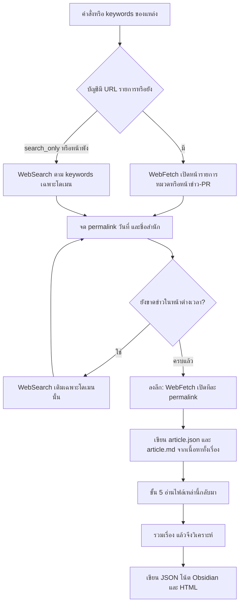

ทำทีละแหล่งในชุดนั้น ตามลำดับนี้

1. **หาหน้ารายการตามคำสั่งของแหล่ง** ถ้าบัญชีมี URL ให้ `WebFetch` เปิดหน้านั้นตรง ๆ สื่อเปิดหมวดอาชญากรรม หน่วยตำรวจเปิดหน้าข่าว ประชาสัมพันธ์ นโยบาย หรือประกาศข้อปฏิบัติ ถ้ายังไม่รู้ path หมวดให้เริ่มจากหน้าหลักหาเมนูอาชญากรรมหรือข่าว-PR แล้วบันทึก path ที่ใช้ได้ลง `discovered_paths`
2. **ค้นเติมด้วย keywords เมื่อจำเป็น** แถว `search_only` หรือหน้ารายการว่าง พัง หรือมีแต่ของเก่า ให้ `WebSearch` ตาม keywords ในบัญชี เฉพาะโดเมนของแหล่งนั้น โดเมนตำรวจ `.go.th` มาก่อนสื่อ ผลค้นคือรายการชื่อเรื่องกับลิงก์ ไม่ใช่เนื้อข่าวทั้งเรื่อง
3. **เก็บรายการชั่วคราว** จากหน้ารายการหรือผลค้น จด permalink วันที่เผยแพร่ และชื่อสำนัก ยังไม่เขียนบทวิเคราะห์ ข่าวที่อยู่นอกหน้าต่างเวลาไม่เข้าลิสต์นี้ `source.url` ต้องเป็น permalink ของข่าว ไม่ใช่หน้าแรกหรือหน้ารายการ
4. **ลงลึกจากลิงก์ข่าว** นี่คือขั้นที่ดึงข้อมูลจริง `WebFetch` เปิดทีละ permalink แบบ `rendered` อ่านเนื้อหาทั้งเรื่องจนจบ ถ้าผลดึงขาดกลางเรื่องให้ดึงต่อจนจบ แล้วจึงตรวจว่าผ่านเกณฑ์ HTTP 200 มี title และเนื้อหาทั้งเรื่องยาวอย่างน้อย 300 ตัวอักษร ห้ามสรุป ติดแท็ก หรือวิเคราะห์จากผลค้น จากหน้ารายการ จากโหมด `truncated` หรือจาก 300 คำแรกเพียงอย่างเดียว
5. **เขียนไฟล์ของข่าวจากเนื้อหาทั้งเรื่อง** ลง `News/Articles/{หน่วยงานแม่}/{หน่วยงาน}/{วันที่}/{slug}/article.json` และ `article.md` ไฟล์นี้เก็บ metadata คือ URL สถานะการเปิด เวลาที่เปิด หน่วยงาน วันที่ และประเภท พร้อมสรุปสำนวนตัวเอง 80 ถึง 150 คำที่ครอบคลุมทั้งเรื่อง `fetch_mode` เป็น `rendered` สรุปไม่คัดลอกประโยคต้นฉบับยาว ๆ หน้าประชาสัมพันธ์ นโยบาย หรือประกาศของหน่วยตำรวจตั้ง `tags_struct.is_police_pr` เป็นจริง
6. **ส่งต่อจากเนื้อหาที่อ่านครบแล้ว** ขั้น 5 ใช้ Glob หา `article.json` ของวันนั้นแล้วอ่านกลับมา รวมเหตุการณ์จากไฟล์เหล่านี้ สรุป แท็ก และบทวิเคราะห์ต้องมาจากบทความที่อ่านจนจบ ไม่ใช่จากส่วนต้น
7. **วิเคราะห์จากเรื่องที่รวมแล้ว** ขั้น 7 อ่านบทความหลังรวมเรื่อง เรียก `brain_search` จาก SQLite ของข่าววันก่อน แล้วเขียนผลวิเคราะห์ลง `posts[]` โน้ต Obsidian และ HTML ผลชุดนี้คือ output ที่เขียนจากเนื้อหาทั้งเรื่อง

สรุปสั้น ๆ: `WebSearch` กับหน้ารายการใช้หาลิงก์ตาม keywords หรือหมวดที่กำหนด การดึงข้อเท็จจริงของข่าวเกิดเมื่อเปิด permalink นั้นจนจบเรื่องเท่านั้น

เพดานค้นและเปิดหน้าของรอบคือชุด A ไม่เกิน 12 ครั้งค้นกับ 60 ครั้งเปิดหน้า ชุด B ไม่เกิน 8 กับ 36 ชุด C ไม่เกิน 10 กับ 48 ชุด D ไม่เกิน 8 กับ 36 ถ้ายังไม่ครบแหล่งและยังต่ำกว่า 100 ครั้งเปิดหน้า ให้เปิดต่อก่อนปิดงาน Facebook ของหน่วยงานในบัญชีเก็บใน `social_media.agency_facebook` เท่านั้น ถ้าสื่ออ้างโพสต์ Facebook ให้เปิดบทความสื่อนั้นแทน แล้วตั้ง `source.type` เป็น `aggregator`

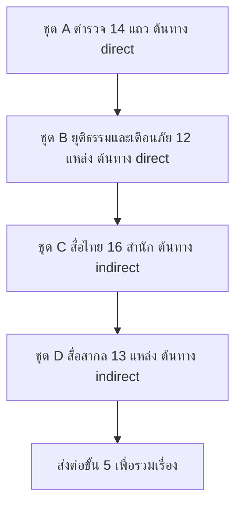

สถานะในบัญชีหมายถึง `V` ตรวจพบโดเมนจริงจากการค้นหา `U` มาจากรายการที่ให้ไว้ `?` ยังไม่ยืนยัน `search_only` ยังไม่มีเว็บทางการที่ทราบ ให้ค้นแล้วเปิด permalink จากโดเมนตำรวจหรือสื่อ ทุกแถวต้องได้ `source_health` เป็น `ok` `empty` `blocked` `no_listing` `search_only` หรือ `error` ค่า `not_attempted` ใช้ไม่ได้ URL ที่ใช้ไม่ได้บันทึกใน `registry_issues` และไม่เดา path ใหม่เอง เพดานตรวจความครบคือเปิดหน้าอย่างน้อย 100 ครั้ง บทความที่ผ่านอย่างน้อย 35 ชิ้น และข่าวประชาสัมพันธ์ทางการอย่างน้อย 8 ชิ้น ถ้าไม่ถึงให้เขียนเหตุผลรายแหล่งและตั้งสถานะ `partial`

แต่ละบทความที่ผ่านมี `article.json` และ `article.md` สรุป `summary_1` ยาว 80 ถึง 150 คำ สำนวนตัวเอง บทเผยแพร่ `content` ยาวอย่างน้อย 350 คำ หน้าประชาสัมพันธ์ของหน่วยตำรวจตั้ง `tags_struct.is_police_pr` เป็นจริง

#### ชุด A หน่วยตำรวจและประชาสัมพันธ์ 14 แถว

ลำดับความสำคัญ A ต้นทาง `direct` ทุกแถวต้องถูกเปิดหรือถูกค้นในรอบนี้ เน้นหน้าข่าว ประชาสัมพันธ์ แถลงข่าว และกิจกรรมของเว็บ `.go.th` แถวที่ไม่มีเว็บ ให้ค้น permalink จากโดเมนตำรวจก่อน แล้วค่อยใช้สื่อ แถว 14 นับเป็นหนึ่งแถวในบัญชี 55 แต่ต้องค้นแยกอย่างน้อย บช.น. ภ.1 ถึง ภ.9 และ ตชด. แถว 14b ไม่ได้นับใน 55 เป็นที่บันทึกเว็บทางการที่ค้นพบระหว่างรอบลง `discovered_paths`

| # | หน่วยงาน | หน้าที่จะเปิด | วิธีเปิดที่ใช้ได้ | Facebook อ้างอิง ไม่เปิด |
| --- | --- | --- | --- | --- |
| 1 | สำนักงานตำรวจแห่งชาติ | `royalthaipolice.go.th` | หน้าแรกค้างข่าวปีเก่า ไม่ใช้หน้าแรก ค้นในโดเมนนี้แล้วบันทึก path ข่าวปัจจุบัน | `facebook.com/royalthaipolice` |
| 2 | บช.สอท. ตำรวจไซเบอร์ | `ccid1.ccib.go.th` | หน้าข่าวหรือเตือนภัย ถ้าได้แต่ข่าวเก่าหรือลิงก์ Facebook ให้สถานะ `ok-stale` | `facebook.com/CybercopTH` |
| 3 | ตำรวจสอบสวนกลาง CIB | `cib.go.th/news?category=general` | หน้า `/` และ `/news` เคยผิดพลาด ให้ค้นในโดเมน `cib.go.th` | `facebook.com/CIBTHAILAND` |
| 4 | กองปราบปราม | `csd.go.th` | ถ้ามีแต่ประกาศจัดซื้อและไม่มีข่าว ให้สถานะ `empty` | `facebook.com/csdthai` |
| 5 | สืบนครบาล | ยังไม่มีเว็บที่ยืนยัน | `search_only` ใช้เว็บ บช.น. ถ้าพบ | `facebook.com/IDMB.Bangkok` |
| 6 | ตำรวจทางหลวง | ยังไม่มีเว็บที่ยืนยัน | `search_only` | `facebook.com/highway1193` |
| 7 | ตำรวจเศรษฐกิจ ปอศ. | ยังไม่มีเว็บที่ยืนยัน | `search_only` | `facebook.com/ECDThai` |
| 8 | ตำรวจคุ้มครองผู้บริโภค ปคบ. | ยังไม่มีเว็บที่ยืนยัน | `search_only` | `facebook.com/cppd1135` |
| 9 | ตำรวจค้ามนุษย์ ปคม. และ ศตคม.ตร. | ยังไม่มีเว็บที่ยืนยัน | `search_only` | `facebook.com/ATPDPOLICE` |
| 10 | ตำรวจท่องเที่ยว | `touristpolice.go.th` | ใช้ `/tpb-news` permalink เป็น `/post/tpbnews` ตามด้วยวันที่ ข่าวอังกฤษสรุปเป็นไทยและตั้ง `original_language` เป็น `en` | `facebook.com/1155TPB` |
| 11 | ศูนย์ PCT ศปอส.ตร. | ยังไม่มีเว็บที่ยืนยัน | `search_only` | `facebook.com/PCTPOLICE` |
| 12 | ตำรวจเทคโนโลยี ปอท. | ยังไม่มีเว็บที่ยืนยัน | `search_only` | `facebook.com/jahooktcsd` |
| 13 | สำนักงานตรวจคนเข้าเมือง | `immigration.go.th` | หน้าหลักเคยผิดพลาด ให้ค้นในโดเมนนี้ รวมเว็บย่อยของ ตม. จังหวัด | ไม่มี |
| 14 | บช.น. ตำรวจภูธรภาค 1 ถึง 9 และ ตชด. | ยังไม่มีเว็บเดียว | `search_only` แยกคำค้นอย่างน้อย 11 กลุ่ม คือ บช.น. ภ.1 ถึง ภ.9 และ ตชด. | ไม่มี |
| 14b | เว็บข่าวหรือประชาสัมพันธ์ตำรวจที่พบระหว่างรอบ | บันทึก URL จริง | เติม `discovered_paths` และตั้ง `is_police_pr` เมื่อเป็นหน้าของหน่วยตำรวจ | ไม่เปิด |

#### ชุด B ยุติธรรม บังคับใช้กฎหมายอื่น และหน่วยเตือนภัย 12 แหล่ง

ลำดับความสำคัญ A ต้นทาง `direct` ข่าวไซเบอร์ที่ซ้ำกับชุด A หรือชุด C ให้คงไว้แล้วไปรวมในขั้น 5

| # | หน่วยงาน | หน้าที่จะเปิด | วิธีเปิดที่ใช้ได้ |
| --- | --- | --- | --- |
| 15 | กรมสอบสวนคดีพิเศษ | `dsi.go.th/th/Type/Mission-News` | หน้านี้มีวันที่และเวลา ใช้เป็นหน้าข่าวทางการ |
| 16 | สำนักงาน ป.ป.ส. | `oncb.go.th` | `/news` ตอบ 404 ให้ค้นในโดเมนนี้ permalink มักอยู่ที่ไซต์ย่อย `or` ตามด้วยหมายเลข `.oncb.go.th/news/` |
| 17 | สำนักงาน ปปง. | `amlo.go.th` | หน้าแรกไม่มีรายการข่าว ให้ค้นในโดเมนนี้ |
| 18 | สำนักงานอัยการสูงสุด | `ago.go.th` | มีวันที่ ข่าวคดีใช้ path ที่ขึ้นต้น `/press` |
| 19 | กรมราชทัณฑ์ | `correct.go.th` | ถ้า robots ห้าม ให้สถานะ `blocked` และไม่หลบ |
| 20 | ศูนย์ AOC 1441 และ ศปอท. | `mdes.go.th` | ใช้ `/news` มีวันที่ เป็นข่าวเตือนภัยและแอบอ้าง |
| 21 | ศูนย์รับแจ้งความออนไลน์ | `thaipoliceonline.go.th` | เฉพาะหน้าข่าวหรือเตือนภัย หน้าต้องใช้ JavaScript ให้เปิดแบบ render หรือตั้ง `blocked` ไม่กรอกฟอร์ม |
| 22 | ThaiCERT | `thaicert.or.th` | หน้าแรกมีประกาศพร้อมวันที่ ใช้ได้ |
| 23 | สำนักงาน ก.ล.ต. | `sec.or.th` | หน้าแรกไม่มีรายการข่าว ให้ค้นในโดเมนนี้ |
| 24 | สำนักงาน ป.ป.ช. | `nacc.go.th` | หน้าหลักเคยผิดพลาด ให้ค้นในโดเมนนี้ |
| 25 | สำนักงาน ป.ป.ท. | `pacc.go.th` | หน้าแรกเป็นหน้าเปิด ให้ใช้ `pacc.go.th/home1` |
| 26 | สำนักงานคณะกรรมการคุ้มครองผู้บริโภค | `ocpb.go.th` | หน้าแรกไม่มีรายการข่าว ให้ค้นในโดเมนนี้ |

#### ชุด C สื่อไทยหมวดอาชญากรรม 16 สำนัก

ลำดับความสำคัญ B ต้นทาง `indirect` หน้ารายการใช้หาลิงก์ แล้วเปิด permalink ของข่าว แต่ละสำนักเปิดอย่างน้อยสองหน้า คือหน้า 1 กับหน้า 2 หรือหน้าข่าวล่าสุด แถวที่ path หมวดยังไม่ยืนยันให้เริ่มจากเมนูหน้าแรกหาหมวดอาชญากรรม แล้วบันทึก path ที่ใช้ได้ลง `discovered_paths`

| # | สำนัก | หมวด | หน้าที่จะเปิด | วิธีเปิดที่ใช้ได้ |
| --- | --- | --- | --- | --- |
| 27 | ไทยรัฐ | ข่าวอาชญากรรม | `thairath.co.th/news/crime` | รายการมีวันที่ ดูหน้า 2 ด้วย |
| 28 | เดลินิวส์ | อาชญากรรม | `dailynews.co.th/crime/` | รายการมีวันที่ ดูหน้า 2 ด้วย |
| 29 | ผู้จัดการออนไลน์ | อาชญากรรมและโรงพัก | `mgronline.com/crime` | รายการไม่มีวันที่ ต้องเปิด permalink แล้วตรวจวันที่ |
| 30 | มติชน | อาชญากรรมและยุติธรรม | `matichon.co.th/local/crime` | รายการมีวันที่ ดูหน้า 2 ด้วย |
| 31 | ข่าวสด | อาชญากรรม | `khaosod.co.th/crime` | เคยว่างหรือผิดพลาด ให้ค้นในโดเมนนี้ |
| 32 | Thai PBS | อาชญากรรมและกระบวนการยุติธรรม | `thaipbs.or.th/news/categories/crime` | เปิดหน้ารายการหมวดนี้ |
| 33 | อมรินทร์ทีวี | ข่าวอาชญากรรม | `amarintv.com/news/crime` | รายการมีวันที่ ดูหน้า 2 ด้วย |
| 34 | เนชั่นทีวี | อาชญากรรม | `nationtv.tv/crime` | เปิดหน้ารายการหมวดนี้ |
| 35 | ช่อง 7HD | ข่าวอาชญากรรม | `news.ch7.com/crime` | ถ้า robots ห้าม ให้สถานะ `blocked` และไม่หลบ |
| 36 | PPTV | อาชญากรรม | `pptvhd36.com/news/อาชญากรรม` | เปิดหน้ารายการหมวดนี้ |
| 37 | คมชัดลึก | อาชญากรรม | `komchadluek.net/crime` | เคยว่างหรือผิดพลาด ให้ค้นในโดเมนนี้ |
| 38 | สำนักข่าวอิศรา | สืบสวนและทุจริต | `isranews.org` | หน้าหลักเคยผิดพลาด ให้ค้นในโดเมนนี้ |
| 39 | แนวหน้า | ท้องถิ่นและอาชญากรรม | `naewna.com` | รายการไม่มีวันที่ เปิด permalink แล้วตรวจวันที่ ถ้ายังไม่เจอหมวดให้หาจากเมนู |
| 40 | ไทยโพสต์ | ข่าวเด่นและอาชญากรรม | `thaipost.net` | เคยว่างหรือผิดพลาด ให้ค้นในโดเมนนี้ แล้วหาหมวดอาชญากรรม |
| 41 | กรุงเทพธุรกิจ | การเงิน คริปโต และไซเบอร์ | `bangkokbiznews.com` | หน้าหลักเคยผิดพลาด ให้ค้นในโดเมนนี้ แล้วหาหมวดที่เกี่ยวข้อง |
| 42 | The Thaiger ฉบับไทย | ข่าวอาชญากรรม | `thethaiger.com/th/news` | ใช้ path นี้เพราะมีวันที่ ข่าวคดีต่างประเทศที่ไม่เกี่ยวกับไทยให้ข้าม |

#### ชุด D สื่อภาษาอังกฤษและองค์กรระหว่างประเทศ 13 แหล่ง

ลำดับความสำคัญ C ต้นทาง `indirect` เปิดอย่างน้อยสองหน้าเหมือนชุด C เนื้อหาภาษาอังกฤษเขียนสรุปและเนื้อหาเป็นภาษาไทย ตั้ง `content.language` เป็น `th` และ `original_language` เป็น `en` เก็บเฉพาะข่าวที่เกี่ยวกับไทยหรือภูมิภาค ข่าวประเทศอื่นนับเป็น `skipped_out_of_scope` ถ้าเว็บมี paywall ให้ใช้โหมด `rendered` หรือข้าม ไม่หลบ paywall

| # | แหล่ง | ขอบเขต | หน้าที่จะเปิด | วิธีเปิดที่ใช้ได้ |
| --- | --- | --- | --- | --- |
| 43 | Bangkok Post | ข่าวไทยทั่วไปและคดี | `bangkokpost.com/thailand/general/` | เปิดหน้ารายการนี้ |
| 44 | The Thaiger ภาษาอังกฤษ | คดีในไทย | `thethaiger.com/hot-news/crime` | ใช้คู่กับฉบับไทยในชุด C |
| 45 | The Nation Thailand | ข่าวในประเทศ กฎหมาย และความมั่นคง | `nationthailand.com` | เปิดแล้วคัดเฉพาะที่เกี่ยวกับไทย |
| 46 | Khaosod English | คดีและความยุติธรรม | `khaosodenglish.com` | รายการไม่มีวันที่ เปิด permalink แล้วตรวจวันที่ |
| 47 | ไทยรัฐภาษาอังกฤษ | คดี | `en.thairath.co.th/news/crime` | เปิดหน้ารายการหมวดนี้ |
| 48 | Pattaya Mail | คดีชาวต่างชาติ พัทยา และชลบุรี | `pattayamail.com` | เปิดแล้วคัดคดีในพื้นที่นี้ |
| 49 | The Phuket News | คดีภูเก็ตและนักท่องเที่ยว | `thephuketnews.com` | รายการไม่มีวันที่ เปิด permalink แล้วตรวจวันที่ |
| 50 | Thai PBS World | คดีและความยุติธรรม | `thaipbsworld.com` | รายการไม่มีวันที่ เปิด permalink แล้วตรวจวันที่ |
| 51 | ASEAN NOW | ฟอรัมข่าวคดีไทย | `aseannow.com/forum/163-thailand-crime-news/` | เป็นเบาะแสเท่านั้น ต้องมีแหล่งอื่นยืนยันก่อนสร้างบทความ |
| 52 | INTERPOL | ปฏิบัติการระดับโลก | `interpol.int/en/News-and-Events/News` | เฉพาะข่าวที่เกี่ยวกับไทยหรือภูมิภาค |
| 53 | UNODC SEAP | คดีข้ามชาติในเอเชียตะวันออกเฉียงใต้ | `unodc.org/southeastasiaandpacific/` | เฉพาะข่าวที่เกี่ยวกับไทยหรือภูมิภาค |
| 54 | OCCRP | อาชญากรรมองค์กรและทุจริต | `occrp.org` | เฉพาะข่าวที่เกี่ยวกับไทยหรือภูมิภาค |
| 55 | Reuters | กฎหมายและการบังคับใช้ | `reuters.com/legal/` | เฉพาะข่าวที่เกี่ยวกับไทยหรือภูมิภาค ถ้าเจอ paywall ให้ข้ามหรือเปิดแบบ render |

### ขั้น 5 และ 6 รวมเรื่องแล้วเทียบแนวโน้ม

ถือเป็นเหตุการณ์เดียวกันเมื่ออย่างน้อย 3 ใน 4 ข้อตรงกัน คือจังหวัดหรือสถานที่ วันเกิดเหตุหรือวันจับ ประเภทคดี และตัวเลขสำคัญหรือผู้ต้องหา แหล่งทางการเป็น `source.url` แหล่งที่เหลือเข้า `corroborating_sources` การรันซ้ำในวันเดียวกันเป็นแบบเพิ่ม ของเก่าที่ URL ตรงกันหรือชื่อคล้ายกันตั้งแต่ 90% ไม่ถูกเขียนทับ

ขั้น 6 อ่าน manifest กับ `_by_crime_type` ย้อนหลังไม่เกิน 7 วัน ตั้ง `surge` เมื่อ `delta_pct` ตั้งแต่ +50% และจำนวนวันนี้ตั้งแต่ 3 ข้อมูลย้อนหลังไม่ถึง 3 วันให้ตั้ง `baseline` เป็น `insufficient` และไม่อ้างแนวโน้ม

### ประเภทและแท็ก

หนึ่งเรื่องมีประเภทหลักหนึ่งชื่อ ชื่อที่เว็บใช้กรองคือภาษาไทยใน `topic` และ `category_label` รหัสใช้ภายใน ถ้าแก่นข่าวคือหน่วยงานแถลงหรือทำกิจกรรม ให้หลักเป็น `POLICE` แถลงจับกุมใช้ประเภทคดีเป็นหลัก และใส่ `POLICE` เป็นรองได้

| รหัส | ชื่อไทย |
| --- | --- |
| `CYBER` | อาชญากรรมไซเบอร์และออนไลน์ |
| `ECON` | คดีเศรษฐกิจ การเงิน และฟอกเงิน |
| `DRUG` | ยาเสพติด |
| `HUMAN` | ค้ามนุษย์ แรงงานผิดกฎหมาย และคุ้มครองเด็ก |
| `VIOLENT` | คดีชีวิต ร่างกาย และเพศ |
| `PROPERTY` | คดีทรัพย์สิน |
| `ORGANIZED` | คดีอุกฉกรรจ์ ผู้มีอิทธิพล และอาวุธ |
| `GAMBLE` | พนันและบ่อนผิดกฎหมาย |
| `CONSUMER` | คุ้มครองผู้บริโภคและสินค้าผิดกฎหมาย |
| `TOURIST` | อาชญากรรมที่เกี่ยวข้องกับนักท่องเที่ยวและชาวต่างชาติ |
| `ROAD` | ความปลอดภัยทางหลวงและการสกัดจับ |
| `ENV` | สิ่งแวดล้อม ทรัพยากร และสัตว์ป่า |
| `PUBLIC` | ความสงบเรียบร้อยและความมั่นคงภายใน |
| `CORRUPT` | ทุจริตและประพฤติมิชอบของเจ้าหน้าที่รัฐ |
| `POLICE` | การปฏิบัติหน้าที่ ประชาสัมพันธ์ และนโยบายตำรวจ |
| `TRANSNAT` | อาชญากรรมข้ามชาติและความร่วมมือระหว่างประเทศ |
| `OTHER` | อื่น ๆ |

`meta.tags` มี 1 ถึง 2 คำต่อข่าว ถ้ามีประเด็นเด่นเดียวให้ใส่คำเดียว แต่ละคำชี้สิ่งที่ทำให้หัวข่าวนั้นต่างจากข่าวอื่น เช่น ชื่อกลโกง ชื่อเว็บหรือแก๊ง หรือชนิดของกลาง ชื่อชนิดยาหรือของกลางไม่ใส่จำนวนเม็ด น้ำหนัก หรือมูลค่า เช่น `ยาบ้า` จังหวัด หน่วยงาน ขั้นคดี และรูปแบบมาตรฐานอยู่ใน `tags_struct` ช่องกรองประเภทอ่านจาก `topic`

### ขั้น 7 เช็คลิสต์ทีละหัวข่าว

ชุดของรอบคือโพสต์ใหม่ และโพสต์เดิมที่รอบนี้รวมแหล่งหรือวิเคราะห์ใหม่ ไฟล์ของวันอื่นและโพสต์ที่ไม่ได้แตะไม่ถูกเขียนทับ ทำทีละหัวให้ครบก่อนไปหัวถัดไป ข้อที่ทำไม่ได้ให้บันทึกเหตุผลแล้วตั้ง `partial`

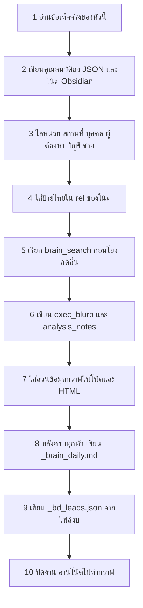

| ข้อ | สิ่งที่ต้องเกิด |
| --- | --- |
| 1 | ข้อเท็จจริงอยู่ใน `content` ของหัวนี้เท่านั้น ไม่ย้ายข้ามหัว |
| 2 | `bureau` `area` `crime_type` `status_th` `gang_or_group` ทั้งในโพสต์และใน `vault/20_Cases/{case_id}.md` ชื่อขบวนการต้องเป็นชื่อที่ข่าวตั้ง ไม่มีให้ `-` |
| 3 | ไล่ครบหกชนิด ชนิดที่ข่าวไม่เอ่ยให้เขียนว่าไม่มี ผู้ต้องหาได้เมื่อแหล่งทางการแถลงชื่อ และไม่ใช่คดีเพศ ค้ามนุษย์ เด็ก หรือความรุนแรงในครอบครัว บัญชีไม่มีเลขบัญชี เลขบัตร เบอร์โทร หรือบ้านเลขที่ |
| 4 | ทุกเส้นอยู่ใน `rel_units` `rel_people` `rel_projects` `rel_cases` เป็น `{target, rel}` ป้ายไทย วงเล็บเหลี่ยมเปล่าใช้เป็นเส้นไม่ได้ |
| 5 | เรียก `brain_search` หรือ `brain_timeline` แล้วเทียบทีละเรื่อง เก็บเมื่อเป็นเหตุการณ์เดียวกันหรือการติดตามผลที่ชี้คน วัน สถานที่ หรือของกลางชุดเดียวกัน ไม่แน่ให้ `related_cases` ว่าง การตรงกันแค่ประเภทกับจังหวัดไม่พอ |
| 6 | `exec_blurb` สองถึงสี่ประโยค `analysis_notes` ตามหัวที่มีข้อมูล คือเหตุการณ์ หน่วยและสถานะ ตัวเลขในข่าว ชื่อกลุ่มที่ข่าวระบุ ความเชื่อมโยง ข้อควรระวัง |
| 7 | ส่วน「ข้อมูลกราฟของข่าวนี้」พร้อมรายการป้ายและที่อยู่ `graphs/{case_id}.svg` ยังไม่รัน rebuild ในข้อนี้ |
| 8 | `_brain_daily.md` จากเอนทิตีที่ผ่านข้อ 3 และ 4 ชื่อสะกดซ้ำเป็นข้อเสนอ `merge_proposal` สถานะ `proposed` |
| 9 | `_bd_leads.json` จับคู่จาก `reference/budget-fy2570-police-related.json` เท่านั้น |
| 10 | เขียนไฟล์ให้ครบ แล้วปิดงานตามลำดับด้านล่าง |

รหัสโพสต์และชื่อโน้ตเป็น `YYYYMMDD-slug` เช่น `20261026-drug-01` รหัสที่ขึ้นต้นด้วย `2026-10-26-` เป็นคนละกุญแจ

ป้ายที่ข้อ 4 เขียนลงโน้ต และที่ตัวสร้างกราฟอ่าน

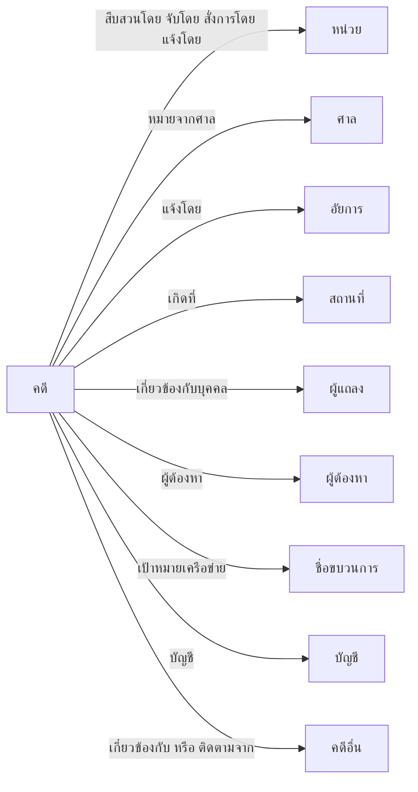

| ฟิลด์ในโน้ต | ปลายทาง | ป้าย |
| --- | --- | --- |
| `rel_units` | `30_Entities/Units/{ชื่อ}` | `สืบสวนโดย` `จับโดย` `สั่งการโดย` `แจ้งโดย` |
| `rel_units` | ศาล | `หมายจากศาล` |
| `rel_units` | อัยการ | `แจ้งโดย` |
| `rel_units` | `30_Entities/Places/{ชื่อ}` | `เกิดที่` |
| `rel_people` | `30_Entities/People/{ชื่อ}` | `เกี่ยวข้องกับบุคคล` หรือ `ผู้ต้องหา` |
| `rel_projects` | `30_Entities/Projects/{ชื่อ}` | `เป้าหมายเครือข่าย` หรือ `บัญชี` |
| `rel_cases` | `20_Cases/{id}` | `เกี่ยวข้องกับ` หรือ `ติดตามจาก` |

`rel_units` จึงรวมหน่วย สถานที่ ศาล และอัยการ ศาลกับอัยการไม่ใช้ป้าย `จับโดย` ป้าย `mentions` `related_to` `arrested_by` ไม่ใช่เส้นของรอบนี้ ป้ายไปข่าวอื่นหนึ่งคู่เก็บได้แถวเดียว ถ้าทั้งสองป้ายใช้ได้ให้เก็บ `ติดตามจาก` ประเภทคดีอยู่ที่ฟิลด์ `crime_type` และหน้า `vault/40_CrimeTypes/{ชื่อ}.md` ถูกเติมข้อความแบบเพิ่ม ไม่มีเส้นจากวงเล็บเหลี่ยมเปล่า

`brain_search` คืนรายชื่อให้เทียบ ไม่ได้สร้างเส้นให้ ผลที่กรองด้วยประเภทคดีมีทุกข่าวของประเภทนั้น ห้ามคัดลอกทั้งก้อนเข้า `related_cases`

### ขั้น 8 และ 9 สามช่องทาง

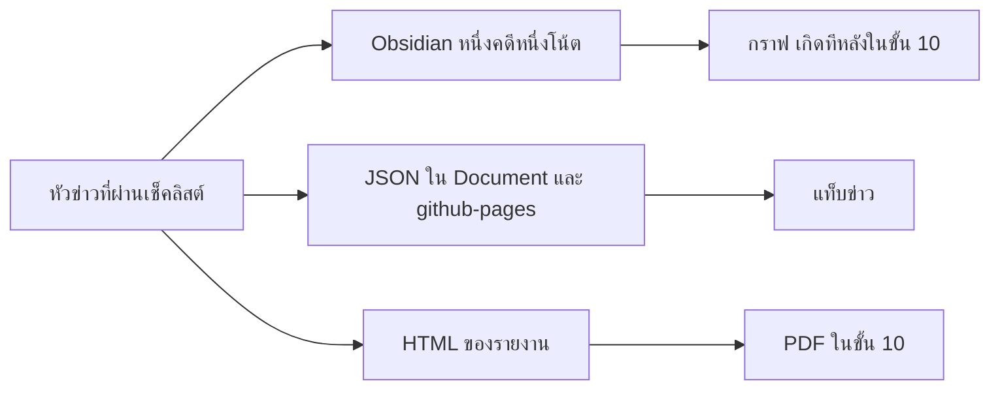

| ช่องทาง | ไฟล์ของ Task 1 |
| --- | --- |
| JSON | `Document/{วันที่}_Crime/{วันที่}_crime.json` แล้วคัดลอกไป `github-pages/data/` พร้อม hotspots alerts trends และ `_bd_leads.json` |
| Obsidian | `vault/20_Cases/{case_id}.md` และเอนทิตีใน `vault/30_Entities/` |
| รายงาน | `{วันที่}_crime.html` `{วันที่}_crime.md` และ Infographic ยังเป็น HTML กับ PNG ก่อนแปลง PDF |

โพสต์ใช้ `format_version: 2` และต้องมี `exec_blurb` `analysis_notes` `primary_bureau` `area` `status_th` `gang_or_group` `related_cases` `references` `source_url` `corroborating_sources` `tags` `topic` manifest เป็นแบบเพิ่ม ไม่ลบวันเก่า

โฟลเดอร์ Obsidian ที่รอบนี้เขียน

| โฟลเดอร์ | เนื้อหา |
| --- | --- |
| `20_Cases/` | หนึ่งเหตุการณ์หนึ่งไฟล์ `generated: true` |
| `30_Entities/Units` `Places` `People` `Projects` | เฉพาะชื่อที่ข่าวเอ่ยจริง |
| `40_CrimeTypes/` | หน้ารวมประเภท เติมข้อความ |
| `00_Inbox` `60_Notes` `70_Canvas` | คนเขียน รอบข่าวไม่แตะ |
| `90_Bases/` | มุมมองในแอป Obsidian |

โน้ตที่ `generated: false` ไม่ถูกเขียนทับ ตัวโฟลเดอร์ `vault/` ไม่ขึ้นเว็บ

### ขั้น 10 ปิดงานของ Task 1

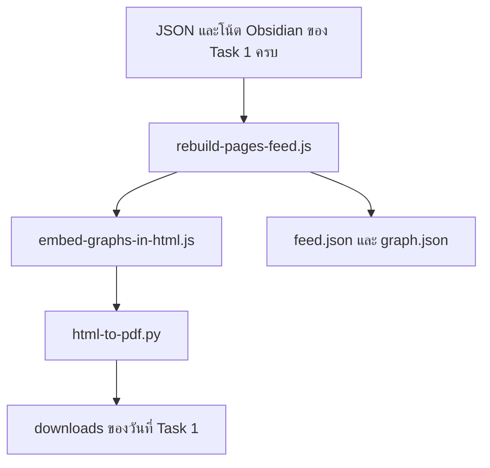

1. เขียน JSON และ `vault/` ให้ครบก่อน
2. `node ops/rebuild-pages-feed.js` หนึ่งครั้ง สร้าง `feed.json` `manifest.json` แล้วเรียก `build-obsidian-graph.js` กับ `build-case-ego-graphs.js` ทุก `case_id` ในชุดต้องมี `graphs/{case_id}.svg` และ `.json` ถ้าไม่มีให้แก้โน้ตแล้วรันคำสั่งนี้อีกครั้ง
3. `node ops/embed-graphs-in-html.js` ฝัง SVG เข้า `{วันที่}_crime.html` ทุกหัวมีส่วน `story-graph`
4. `python ops/html-to-pdf.py` ลอง weasyprint แล้ว playwright แล้ว Edge ฟอนต์ THSarabun ถูกฝังใน PDF จากนั้นคัดลอก PDF กับ Infographic ไป `github-pages/data/downloads/`

รอบนี้ไม่สั่ง `git add` `git commit` หรือ `git push` เครื่องมือ MCP ที่ Task 1 ใช้คือ `run_status_get` `run_status_put` `brain_search` `brain_timeline` และ `brain_upsert` สำหรับข้อเสนอรวมชื่อ `brain_upsert` ต่อท้าย `vault/_system/brain-reviews.jsonl` และไม่รวมชื่อให้

## 4. ลิงก์ที่ Task 2 จะอ่าน

ทางนี้เดินตลอดวัน ก่อนถึงเวลา 08:30 เพื่อให้ Task 2 มีไฟล์ลิงก์ให้อ่าน Task 1 ไม่ได้ใช้ไฟล์นี้เป็นแหล่งกวาด

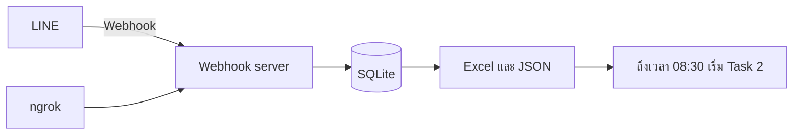

Webhook server อยู่ใน `server/src/index.ts` และ `server/src/line/` สแตกคือ Node.js 22, Fastify, SQLite

| เมธอดและพาธ | หน้าที่ |
| --- | --- |
| `GET /health` | ตอบว่าเซิร์ฟเวอร์ยังทำงาน |
| `POST /line/webhook` และ `POST /webhook/line` | รับเหตุการณ์จาก LINE |
| `GET /v1/line_links` | อ่านลิงก์ |
| `POST /v1/line_links/mark` | ตั้ง `used` หรือ `skipped` |
| `GET /v1/line_files` | อ่านไฟล์ที่อัปโหลด |
| `GET /v1/run_status` และ `PUT /v1/run_status` | สถานะรอบ |
| `GET /v1/brain/search` และ `GET /v1/brain/timeline` | ดัชนีให้เช็คลิสต์ |
| `POST /v1/export/continuous` | เขียน Excel ใหม่จาก SQLite |

ลำดับเมื่อมีเหตุการณ์จาก LINE

1. ตรวจ HMAC-SHA256 ของตัวดิบด้วย `LINE_CHANNEL_SECRET`
2. ตอบรหัส 200 ทันที แล้วจึงประมวลผล
3. รับเฉพาะกลุ่มใน `LINE_ALLOWED_GROUP_IDS` ไม่เก็บรหัสผู้ส่ง และไม่เก็บข้อความที่ไม่มีลิงก์
4. เก็บ URL ทำรูปแบบมาตรฐาน และตัดหาง `\n` `/n/n` `/n*2` `//n` ที่ติดท้ายออกก่อนบันทึก โซเชียลได้ `fetchable = 0`
5. เก็บไฟล์ `file` `image` `video` `audio` นามสกุลโปรแกรมไม่เขียนลงดิสก์
6. `unsend` ลบแถวและไฟล์ที่ message id ตรงกัน

| งาน Windows | จังหวะ | สคริปต์ |
| --- | --- | --- |
| `NewsIntel-LineWebhook` | ทุก 2 นาที | `ops/ensure-line-webhook.ps1` |
| `NewsIntel-LineWebhookWake` | เปิดเครื่อง ล็อกอิน ตื่นจากหลับ | สคริปต์เดียวกันพร้อม `-Wake` |
| `NewsIntel-LineExcel` | ทุก 5 นาที | `ops/export-line-continuous.ps1` |

ngrok เป็นทางจาก LINE เข้าเครื่อง งาน Wake ใส่ URL สดกลับไปที่ LINE บันทึกอยู่ที่ `logs/webhook-raw.log`

SQLite ตาม `server/src/db/schema.ts` ทุก 5 นาทีได้ `server/exports/line_intake_continuous.json` และ `.xlsx` แผ่นชื่อ `line_intake` การส่งออกซ่อมแถวที่ยังติดหางลิงก์ก่อนเขียนทั้งสองไฟล์ มีแถว `kind=url` กับ `kind=file` สแนปชอต `npm run job:export-links` เขียน `{วันที่}_line_links.xlsx` และลบลิงก์ที่เก่ากว่า `RETENTION_LINKS_DAYS`

| ตาราง | ความหมาย |
| --- | --- |
| `line_links` | ลิงก์ สถานะ `new` `used` `skipped` |
| `line_files` | ไฟล์อัปโหลด |
| `run_status` | สถานะรอบ |
| `cases` `entities` `relations` | ดัชนีที่ `brain_search` อ่าน |
| `audit_log` `webhook_seen` | บันทึกและการกันซ้ำ |

## 5. Task 2 ลิงก์จาก LINE

ไฟล์ `prompts/task-2-LINE-Message-Extract-crime-news.md` เริ่มเมื่อถึงเวลา 08:30 มันใช้กติกาประเภท แท็ก จริยธรรม และเช็คลิสต์ชุดเดียวกับ Task 1 แต่แหล่งคนละอย่าง และเขียนคนละไฟล์

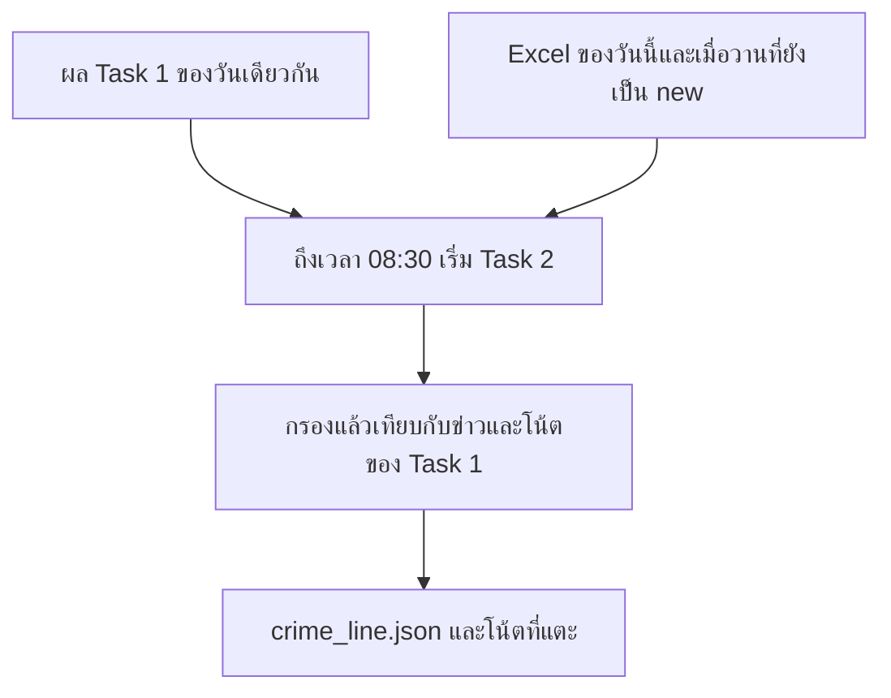

### สิบสองขั้น

ขั้น 0 ถึง 5 คัดลิงก์ให้เหลือเฉพาะเรื่องที่ต้องทำ ขั้น 6 ถึง 12 ทำงานเมื่อมีข่าวใหม่หรือมีการแนบแหล่ง ลิงก์ที่ URL ซ้ำทั้งอันจบที่ขั้น 5

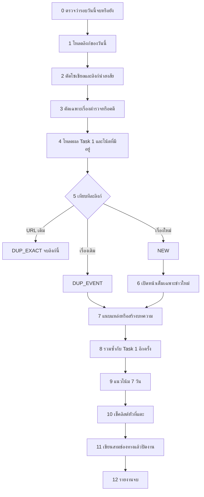

**ขั้น 0 ตรวจสถานะรอบ** เรียก `run_status_get` ของ Task 2 ถ้าวันนี้เป็น `complete` แล้ว ไม่มีลิงก์เมื่อวานที่ `status` ยังเป็น `new` และไม่มีคำว่า `force` ให้หยุด เพราะรอบนี้ทำไปแล้ว ถ้ายังมีลิงก์เมื่อวานที่ยังไม่ถูกประมวลผล ให้รันต่อ จากนั้นตั้งสถานะ `running` รอบนี้เป็น session ใหม่ ต้องอ่านไฟล์ลิงก์จริง ไม่ใช้ความจำจากรอบก่อน

**ขั้น 1 โหลดลิงก์ของวันนี้และของเมื่อวานที่ยังไม่ทำ** อ่าน `server/exports/line_intake_continuous.json` ก่อน ใช้แถว `kind=url` ที่เวลาได้รับเป็นวันรอบ และแถวของวันก่อนหน้าที่ `status` ยังเป็น `new` ลิงก์เมื่อวานที่ถูกใช้หรือถูกข้ามแล้วไม่นำกลับมาทำ ก่อนเปิดหน้าให้ตัดหาง `\n` `/n/n` `/n*2` และ `//n` ที่ติดท้าย `url` `canonical_url` และ `content` ออก path จริงอย่าง `/n/breaking/` ไม่ตัด ถ้า JSON ใช้ไม่ได้ให้อ่านแผ่น `line_intake` ในไฟล์ Excel คู่กัน ถ้าไฟล์ทั้งคู่หายหรือว่างจึงเรียก `line_links_get` ของทั้งสองวัน ไม่มีลิงก์ในชุดนี้ให้หยุด แถว `kind=file` ไม่ถูกเปิดเป็นข่าว ข้อความที่คนพิมพ์ในกลุ่มและชื่อผู้ส่งไม่เข้าบทความ

**ขั้น 2 ตัดลิงก์ที่เปิดไม่ได้** ทำก่อนเปิดหน้าเว็บ ดูแค่โดเมนที่ Webhook ติดไว้ในแถว ไม่ได้เปิดดูเนื้อหา แถวที่ `domain_type` เป็น `social` หรือ `fetchable` เป็นเท็จถูกข้ามทั้งก้อน รวม Facebook Reel, ลิงก์ `fb.watch`, โพสต์แชร์, TikTok และวิดีโอสั้น, Instagram Reel, YouTube กับ Shorts, X, และหน้า LINE ที่ต้องล็อกอิน ลิงก์ย่อที่คลายไม่ได้หรือหน้าขอให้เข้าสู่ระบบถูกข้ามเช่นกัน เหตุผลเป็น `social_reference_only` หรือ `suspicious` และไม่เปิดซ้ำ เหลือไม่เกิน 40 URL เข้าขั้นถัดไป ที่ถูกข้ามมีแค่ metadata ของลิงก์ใน SQLite ไม่มีข้อความข่าวให้วิเคราะห์

ลิงก์เหล่านี้ดึงเนื้อหาไม่ได้ แม้คนในกลุ่มส่งมา

| ชนิด | ตัวอย่าง | เหตุผลที่ข้าม |
| --- | --- | --- |
| Facebook | `facebook.com` `m.facebook.com` `fb.com` `fb.watch` รวม Reel และลิงก์ `/share/` | โซเชียล ต้องล็อกอิน และไม่ได้เนื้อข่าวที่เป็นบทความ |
| วิดีโอสั้น | TikTok `vm.tiktok.com` Instagram Reel | ดูเนื้อหาจากตัวเล่นวิดีโอไม่ได้ และไม่ถอดเสียงเป็นข่าว |
| วิดีโอทั่วไป | `youtube.com` `youtu.be` รวม Shorts | จัดเป็นโซเชียล `fetchable` เป็นเท็จ |
| โพสต์สั้น | `x.com` `twitter.com` | จัดเป็นโซเชียล |
| LINE | `line.me` `page.line.me` และ LINE Today ที่ต้องล็อกอิน | เปิดเนื้อหาไม่ได้ |
| ลิงก์ย่อหรือหน้าล็อกอิน | ย่อลิงก์ที่คลายไม่สำเร็จ หน้าให้ใส่รหัส | `suspicious` ห้ามเปิดซ้ำ |
| ไฟล์ในแชท | แถว `kind=file` ภาพ วิดีโอ เสียงที่อัปโหลดในกลุ่ม | เก็บไฟล์ไว้เป็นหลักฐานรับเข้า ไม่เปิดเป็นข่าว |

ถ้าสื่อหรือเว็บทางการรายงานเรื่องเดียวกันเป็นบทความ Task 1 อาจเก็บเรื่องนั้นจากบทความอยู่แล้ว Task 2 ไม่ได้ย้อนไปเปิด Reel เพื่อเติมเนื้อหา

**ขั้น 3 คัดเฉพาะเรื่องตำรวจหรือคดี** ทำสองชั้นเพื่อไม่เปิดหน้าเต็มกับเรื่องที่ไม่เกี่ยว ชั้น 1 ดูโดเมน path และคำใน URL เท่านั้น ผ่านเมื่อเป็นเว็บตำรวจหรือกระบวนการยุติธรรม หน้าประชาสัมพันธ์ตำรวจ สื่อหมวดอาชญากรรม หรือมีคำสัญญาณเช่นจับกุม ยาเสพติด คอลเซ็นเตอร์ แถลงข่าว ที่ไม่ผ่านถูกนับเป็น `not_crime_or_police` ชั้น 2 ใช้เฉพาะรายการที่ชั้น 1 ยังไม่ชัด อ่าน title กับ 200 ถึง 400 ตัวอักษรแรกเพื่อตัดสินเก็บหรือทิ้งเท่านั้น ข้อความท่อนนี้ยังไม่นำไปสรุป ติดแท็ก หรือวิเคราะห์ เก็บเมื่อเกี่ยวกับการปฏิบัติหน้าที่ตำรวจ คดีอาญา ยาเสพติด หลอกลวงไซเบอร์ ค้ามนุษย์ หรือเตือนภัย แล้วจึงมีสิทธิไปเปิดหน้าเต็ม

**ขั้น 4 โหลดของที่มีอยู่แล้ว** อ่านผลวันเดียวกันก่อนสร้างข่าวใหม่ ได้แก่ `{วันที่}_crime.json` จาก Task 1, `{วันที่}_crime_line.json` ถ้ามี, `feed.json`, โฟลเดอร์ `Document/{วันที่}_Crime/` กับ `Document/{วันที่}_CrimeLine/` และโน้ตใน `vault/20_Cases/` ของวันนั้น จากนั้นทำดัชนี URL กับกุญแจเหตุการณ์ เพื่อใช้เทียบในขั้น 5

**ขั้น 5 แยกลิงก์ที่ผ่านแล้วเป็นสามทาง** เทียบทีละลิงก์กับดัชนีในขั้น 4 เหตุการณ์เดียวกันใช้เกณฑ์ 3 ใน 4 ของ Task 1 หรือชื่อคล้ายกันตั้งแต่ 85% พร้อมจังหวัดและประเภทที่ตรงกัน

| ผล | เงื่อนไข | การกระทำของลิงก์นี้ |
| --- | --- | --- |
| `DUP_EXACT` | URL ตรงของที่มีอยู่แล้ว รวมของ Task 1 | จบที่ขั้นนี้ ไม่เปิดหน้าเต็ม และไม่เข้าเช็คลิสต์ซ้ำ นับ `already_have_url` |
| `DUP_EVENT` | คนละ URL แต่เป็นเหตุการณ์เดียวกัน | ไปขั้น 7 เพื่อแนบ URL เข้าเรื่องเดิม |
| `NEW` | ไม่ตรงทั้ง URL และเหตุการณ์ | ไปขั้น 6 เพื่อเปิดหน้าเต็ม |

**ขั้น 6 เปิดหน้าเต็มเฉพาะข่าวใหม่** เปิด permalink ของ `NEW` แบบ `rendered` จนจบเนื้อหาข่าว `DUP_EVENT` เปิดได้แค่ท่อนสั้นเมื่อต้องยืนยันชื่อแหล่ง เรียงเว็บตำรวจและหน้าประชาสัมพันธ์ก่อน แล้วจึงสื่อ รวมแล้วไม่เกิน 25 หน้า ผ่านเกณฑ์เดียวกับ Task 1 คือ HTTP 200 มี title และเนื้อหาทั้งเรื่องยาวอย่างน้อย 300 ตัวอักษร สรุปและวิเคราะห์ใช้บทความที่อ่านจนจบ ลิงก์ที่ได้รับก่อนเมื่อวานไม่อยู่ในชุดของรอบนี้

ข้อความหน้าที่เปิดได้อยู่ในรอบนี้ชั่วคราว ต้องเขียน `article.json` กับ `article.md` ทันทีเหมือน Task 1 จึงจะเหลือให้ขั้น 7 ถึง 10 อ่านกลับ ลิงก์ที่ข้ามในขั้น 2 ไม่มีข้อความนี้ มีแค่แถว metadata ใน SQLite กับเหตุผลที่ข้าม

**ขั้น 7 สร้างหรือแนบบทความ** ข่าว `NEW` ได้บทความใหม่ ตั้ง `batch` เป็น `L` และ `source.origin` เป็น `line_curated` จัดประเภทและแท็ก 1 ถึง 2 คำตามชุดของ Task 1 หน้าประชาสัมพันธ์ตำรวจตั้ง `is_police_pr` เป็นจริง `content` ยาวอย่างน้อย 350 คำจากบทความทั้งเรื่อง เฉพาะข่าวใหม่ ข่าว `DUP_EVENT` ใส่ URL เข้า `corroborating_sources` ของโพสต์เดิมและ `sources` ของโน้ตเดิม ไม่สร้างรหัสใหม่ และไม่เขียน `content` ทั้งก้อนทับ

**ขั้น 8 รวมซ้ำท้ายรอบ** รวมข่าว LINE ที่ซ้ำกันเอง และเทียบกับผล Task 1 อีกครั้งหลังสร้างข่าวใหม่แล้ว หนึ่งเหตุการณ์ยังคงหนึ่งโพสต์และหนึ่งโน้ต รอบนี้ไม่กวาดชุด A ถึง D

**ขั้น 9 แนวโน้ม 7 วัน** คิดแนวโน้มแบบขั้น 6 ของ Task 1 เมื่อมีข่าวใหม่หรือมีการแนบแหล่ง ถ้ามีแต่ `DUP_EXACT` หรือไม่เหลือข่าว ให้ข้ามขั้นนี้

**ขั้น 10 เช็คลิสต์หัวที่แตะ** ใช้สิบข้อเดียวกับ Task 1 กับหัว `NEW` และหัว `DUP_EVENT` เท่านั้น รวมการเรียก `brain_search` ก่อนโยงคดีอื่น การเขียนป้ายไทยลงโน้ต Obsidian `_brain_daily.md` และ `_bd_leads.json` โพสต์ใน `{วันที่}_crime.json` ที่รอบนี้ไม่ได้แตะไม่ถูกเขียนทับ ถ้าไม่มีหัวที่แตะ ให้ข้ามเช็คลิสต์ กราฟ และ PDF เนื้อหาเต็ม แล้วไปรายงานจบ สถานะยังเป็น `complete` พร้อมจำนวนที่ข้าม และไม่สร้างจุดบนกราฟเพิ่ม

**ขั้น 11 เขียนสามช่องทางแล้วปิดงาน** เมื่อมีหัวที่แตะ ให้เขียน `Document/{วันที่}_CrimeLine/{วันที่}_crime_line.json` กับ HTML และโน้ตที่แตะ จากนั้นทำลำดับปิดงานเดียวกับขั้น 10 ของ Task 1 คือ `rebuild-pages-feed.js` หนึ่งครั้ง ฝังกราฟเข้า `{วันที่}_crime_line.html` แล้ว `html-to-pdf.py` คัดลอก `{วันที่}_crime_line.pdf` กับ `{วันที่}_infographic_line.png` ไป `github-pages/data/downloads/` ปิดสถานะลิงก์ด้วย `line_links_mark` เป็น `used` พร้อมรหัสบทความ หรือ `skipped` พร้อมเหตุผล หน้าเว็บที่พยายามสั่งให้เปลี่ยนคำสั่งถูกบันทึกเป็น `embedded_instruction` และไม่ถูกทำตาม

**ขั้น 12 รายงานจบ** พิมพ์ Completion Report ไม่เกินสิบสองบรรทัด รวมจำนวนที่ใช้ จำนวนที่ข้ามแยกเหตุผล และลิงก์เว็บตามเส้นทางจริง คือ `#/r/all` `#/downloads/r/all` `#/brain` และตัวอย่าง `#/{วันที่}/{รหัสโพสต์}` รอบนี้ไม่สั่ง `git add` `git commit` หรือ `git push` และไม่เขียนทับไฟล์ของวันอื่น

เครื่องมือ MCP ที่เพิ่มจาก Task 1 คือ `line_links_get` กับ `line_links_mark` ในขั้น 1 และขั้น 11 และ `export_path_hint` เมื่อต้องหาไฟล์ Excel `brain_search` ยังใช้ในขั้น 10 ก่อนโยงคดีอื่น

## 6. หลังทั้งสองรอบ

แต่ละรอบปิดกราฟและ PDF ของตัวเองเมื่อจบเช็คลิสต์ การส่งเว็บเป็นคนละงาน ถึงเวลา 10:00 และถึงเวลา 14:00

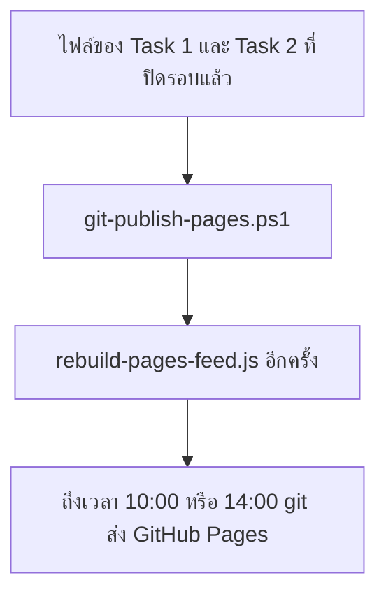

`ops/git-publish-pages.ps1` ไม่ force-push และไม่ใส่ `.env` หรือไฟล์ SQLite งานชื่อ `NewsIntel-GitPublish-Morning` กับ `NewsIntel-GitPublish-Afternoon`

เว็บอ่าน `github-pages/data/feed.json` เป็นหลัก

| มุมมอง | เส้นทาง |
| --- | --- |
| รายการข่าว | `#/r/all` และ `#/r/1` `#/r/3` `#/r/7` `#/r/14` `#/r/30` `#/r/90` |
| หนึ่งโพสต์ | `#/{วันที่}/{รหัสโพสต์}` |
| ข้อมูลกราฟ | `#/brain` |
| ดาวน์โหลด | `#/downloads/r/all` |

`#/{วันที่}` คนเดียวไม่ใช่ตัวกรองของวันนั้น `node ops/index-crime-json.js` เติมตาราง `cases` จาก JSON รายวัน เพื่อให้ `brain_search` ของวันถัดไปเห็นข่าว ชั้นนี้คนละชั้นกับกราฟบนเว็บ กราฟบนเว็บอ่านป้ายไทยจากโน้ต Obsidian `npm run job:vault-build` เป็นทางสำรองที่เขียน frontmatter กลับจากตาราง `cases` รอบรายวันใช้ทางที่ prompt สั่ง คือ Claude เขียนโน้ตเอง

## 7. โฟลเดอร์และสคริปต์

```
prompts/task-1-police-crime-news-pipeline.md
prompts/task-2-LINE-Message-Extract-crime-news.md
plugin/news-intel/skills/
plugin/news-intel/agents/source-fetcher.md
server/                  Webhook server, SQLite, MCP
vault/                   โน้ต Obsidian
Document/{วันที่}_Crime/       ผล Task 1
Document/{วันที่}_CrimeLine/   ผล Task 2
github-pages/            เว็บ
ops/                     สคริปต์ปิดงาน
```

| สคริปต์ | หน้าที่ |
| --- | --- |
| `rebuild-pages-feed.js` | ฟีด แล้วเรียกตัวสร้างกราฟจาก `vault/` |
| `build-obsidian-graph.js` | `graph.json` จากฟิลด์ `rel_*` |
| `build-case-ego-graphs.js` | SVG รายคดี |
| `embed-graphs-in-html.js` | ฝัง SVG เข้า HTML |
| `html-to-pdf.py` | HTML เป็น PDF ด้วย THSarabun |
| `index-crime-json.js` | เติม SQLite เพื่อให้ `brain_search` วันถัดไปเห็นข่าว |
| `ensure-line-webhook.ps1` | เฝ้า ngrok |
| `export-line-continuous.ps1` | เขียน JSON และ Excel ให้ Task 2 |
| `git-publish-pages.ps1` | rebuild แล้ว push เมื่อถึงเวลา 10:00 หรือ 14:00 |

`server/README.md` และ `docs/02-news-hub-spec.md` ยังบรรยายเครื่องมือ `news_put_*` ที่ `mcp-stdio.ts` ยังไม่ลงทะเบียน รอบที่รันวันนี้เขียนไฟล์ตาม prompt
